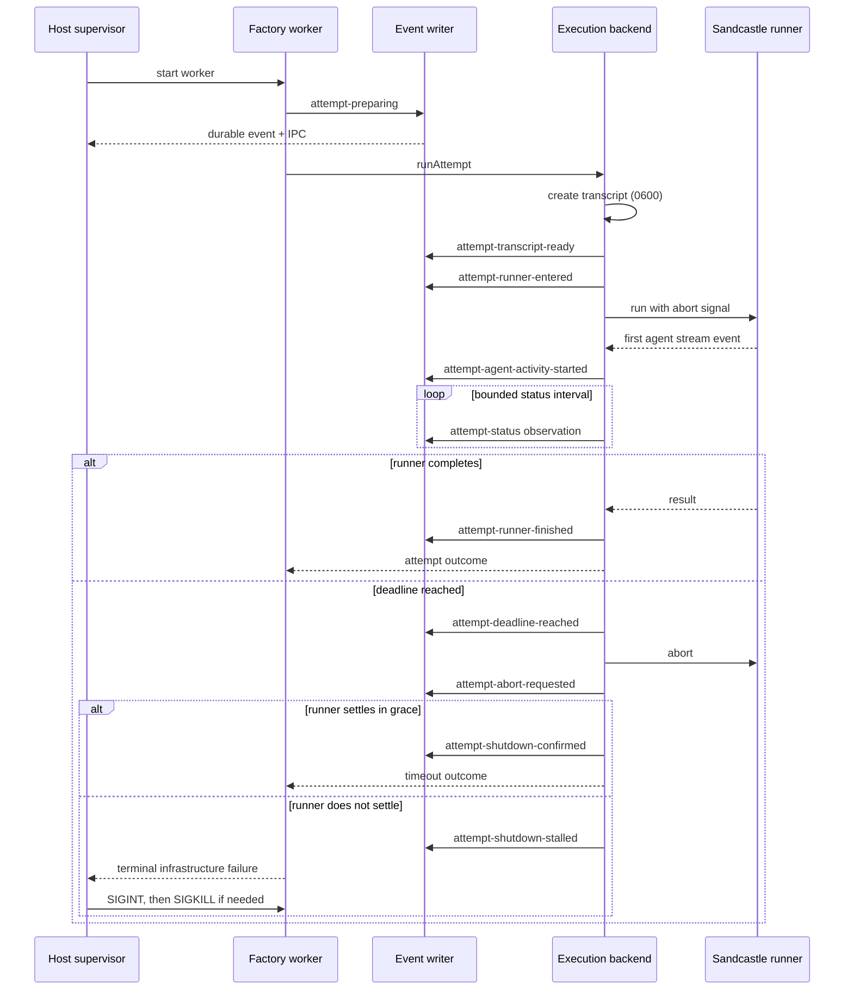

# Orchestrator observability and stall containment — implementation plan

Status: implemented and verified. `npm run check` passes; the supervised non-cooperative-runner smoke recorded early transcript creation, status observations, absolute deadline, abort request, `attempt-shutdown-stalled`, `SIGINT`, and no later stage.

## 1. Outcome

Every run must answer these questions from host-owned evidence while it is still running:

1. Which operation is active?
2. When did it start, and what absolute deadline applies?
3. Did the attempt transcript get created?
4. Has Sandcastle entered, has the sandbox started, and has the agent produced output?
5. Was cancellation requested, and was process/container shutdown confirmed?
6. What is the last durable transition if the worker is killed?

A runner that ignores cancellation must not permit a retry or later stage to start beside it. It must become a terminal infrastructure failure, after which an outer supervisor terminates the worker and records the failure boundary.

## 2. Current failure and evidence

The observed `1791555474-feature-refactor-1` attempt emitted `attempt-execution-started` and Sandcastle printed `Started on branch`, but no transcript appeared.

That state is possible because:

- `packages/execution-backend/src/execution-backend.ts` creates only the `transcripts/` directory before calling the runner.
- Sandcastle prints its `Started` message before its `FileDisplay` layer creates the file.
- `attempt-execution-started`, gate starts, and stage checkpoint starts are live `progress` callbacks only; most are absent from `events.jsonl`.
- The 600-second Sandcastle idle timeout begins around agent invocation, after startup work.
- The backend deadline aborts a signal but still awaits the runner. A non-cooperative startup path can therefore remain unresolved.
- The proof launcher has an external watchdog, but the normal factory CLI does not.
- Events have no schema version, sequence, timestamp, elapsed duration, or common operation identity.

The immediate defect is an unobservable gap between the optimistic startup line and transcript/logger initialization. The broader defect is split ownership of live progress, durable evidence, attempt deadlines, and outer process supervision.

## 3. Scope

### In scope

- One typed run-event contract shared by factory policy and adapters.
- One ordered event writer for both durable `events.jsonl` evidence and live `FACTORY_PROGRESS` output.
- Attempt transcripts created before Sandcastle is entered.
- Attempt lifecycle events from invocation preparation through confirmed shutdown.
- Bounded deadline, abort, and shutdown-grace behavior.
- External no-progress supervision for normal CLI runs and proof runs.
- Operator-facing status details, terminal diagnostics, and runbook updates.
- Deterministic tests plus one real-process stalled-attempt smoke scenario.

### Non-goals

- Distributed tracing, OpenTelemetry, metrics backends, dashboards, or remote log shipping.
- Automatic run resume.
- Persisting prompts, model text, secrets, environment variables, or tool arguments in progress events.
- Parsing Sandcastle’s human-readable transcript as orchestration state.
- Retrying while an earlier attempt may still own a process or container.
- Replacing Sandcastle or redesigning stage policy.

## 4. Decisions

### 4.1 Use one event path

Replace direct mixtures of `artifacts.record(...)` and `progress?.(...)` with a run-scoped `RunEventWriter` owned by `executeTicket`.

`emit` must:

1. Assign `schemaVersion`, a strictly increasing `sequence`, `occurredAt`, and `runElapsedMs`.
2. Append the complete event to `events.jsonl`.
3. Publish that same event to the live observer used by the CLI/supervisor.

Durability comes first. A live event must never claim a boundary that failed to persist. The writer serializes events; callers do not assign sequence numbers.

Keep `RunArtifactsPort.attach` and `finalize` unchanged. Replace `RunArtifactsPort.record` usage outside the writer so there is one event-ordering authority.

### 4.2 Separate transitions from observations

Events have one of two classes:

- `transition`: a state boundary; updates the supervisor’s active operation and deadline.
- `observation`: periodic status such as transcript size or last agent activity; visible to operators but cannot extend an absolute deadline.

This prevents heartbeats from masking a stuck operation.

### 4.3 Use absolute deadlines

Every blocking transition includes `deadlineAt`. The supervisor arms against that absolute instant rather than repeatedly extending a relative timeout when another event arrives.

The attempt deadline remains the policy deadline. Add a separately configured shutdown grace, initially 10 seconds. Snapshot and other host operations retain `orchestrationTimeoutMs`.

### 4.4 Create the transcript before runner entry

The execution backend must exclusively create the transcript with mode `0600` before invoking Sandcastle. Its initial header contains only:

- attempt, run, stage, and session identities;
- creation timestamp;
- absolute attempt deadline;
- `lifecycle: transcript-ready`.

Sandcastle appends to that existing file. Backend lifecycle lines may also be appended, but prompts, endpoint credentials, environment values, and model output must remain excluded. Existing final redaction remains defense in depth.

If transcript creation fails, the runner is never called and the attempt returns an execution failure with a durable event naming the failed operation.

### 4.5 Make shutdown confirmation a hard invariant

At the attempt deadline:

1. Emit `attempt-deadline-reached`.
2. Abort the runner signal.
3. Emit `attempt-abort-requested`.
4. Wait at most `attemptShutdownGraceMs` for runner settlement.
5. On settlement, emit `attempt-shutdown-confirmed` and return a timeout outcome.
6. Without settlement, emit `attempt-shutdown-stalled`, stop orchestration, and surface a terminal infrastructure failure. Do not start recovery.

A plain `Promise.race` that returns while runner work continues is prohibited. The outer worker supervisor owns final `SIGINT`/`SIGKILL` containment when in-process shutdown cannot be confirmed.

### 4.6 Supervise every CLI run

Extract the current proof worker supervisor into a reusable host-owned module. Both `apps/factory-cli` and `proof/harness/run-proof.ts` launch the actual orchestration in a child worker with IPC progress.

The supervisor writes `supervisor.json` atomically and records:

- worker start/end timestamps and PID;
- exit code or signal;
- whether a deadline or no-progress watchdog fired;
- active operation and its absolute deadline;
- last durable transition;
- last observation;
- `SIGINT` and `SIGKILL` timestamps;
- diagnostic reason.

The supervisor must never infer success from worker exit alone; the existing terminal report remains authoritative.

## 5. Event contract

Add a discriminated `RunEvent` union in `packages/factory/src/contracts.ts`. Do not keep the current unrestricted `type: string` event as the internal API.

Common envelope:

```ts
interface RunEventEnvelope {
  readonly schemaVersion: 1;
  readonly sequence: number;
  readonly runId: string;
  readonly occurredAt: string;
  readonly runElapsedMs: number;
  readonly eventClass: "transition" | "observation";
  readonly stage?: AttemptTask;
  readonly attempt?: number;
  readonly operationId?: string;
  readonly deadlineAt?: string;
  readonly details: Readonly<Record<string, unknown>>;
}
```

Initial event catalog:

| Event | Class | Required details |
|---|---|---|
| `run-preparing` / `run-started` | transition | repository/base/output identity; resolved base commit on start |
| `preflight-started` / `preflight-finished` | transition | operation ID; result and check count on finish |
| `workspace-snapshot-started` / `workspace-snapshot-finished` | transition | label, deadline; snapshot/tree identity on finish |
| `attempt-preparing` | transition | attempt/session identity and deadline |
| `attempt-transcript-ready` | transition | host transcript path |
| `attempt-runner-entered` | transition | runner name and sandbox kind, never endpoint credentials |
| `attempt-agent-activity-started` | transition | first stream timestamp |
| `attempt-status` | observation | elapsed, remaining, transcript bytes/mtime, last agent activity; no content |
| `attempt-deadline-reached` | transition | deadline and elapsed time |
| `attempt-abort-requested` | transition | cause and shutdown-grace deadline |
| `attempt-shutdown-confirmed` | transition | settlement duration and outcome |
| `attempt-shutdown-stalled` | transition | grace duration and last known lifecycle boundary |
| `attempt-runner-finished` | transition | completed/failure/timeout/cancelled and runtime session presence |
| `attempt-report-accepted` / `attempt-report-rejected` | transition | report status or validation problems |
| `gate-started` / `gate-finished` | transition | gate name, deadline when applicable, result/check count |
| `stage-finished` | transition | accepted or exhausted, suite version where applicable |
| `analysis-workspace-started` / `analysis-workspace-ready` / `analysis-workspace-finished` | transition | source snapshot, materialized tree, and confirmed disposal |
| `run-finalizing` / `run-finished` | transition | terminal status and reason |

Avoid duplicate aliases such as both `stage-checkpoint-completed` and `stage-report-accepted`. One name must represent one state transition.

## 6. Runtime flow



## 7. Implementation slices

### Slice A — event model and writer

Files:

- `packages/factory/src/contracts.ts`
- new `packages/factory/src/run-event-writer.ts`
- `packages/factory/src/execute-ticket/execute-ticket.ts`
- `packages/run-artifacts/src/file-run-artifacts.ts`
- corresponding tests

Changes:

1. Add the typed envelope and event union.
2. Inject a clock into `RunEventWriter` for deterministic timestamps and elapsed durations.
3. Serialize every event through one promise chain.
4. Route all current snapshots, gates, attempts, corrections, pull-request drafting, publication, and terminal outcomes through the writer.
5. Persist starts and failures, not only completions.
6. Keep final reports compatible by embedding the new versioned event objects; bump `reportVersion` only if the report schema itself changes.

Checkpoint: a successful mocked run has contiguous sequences, durable/live equality, and an explicit active boundary for every blocking call.

### Slice B — backend lifecycle and early transcript

Files:

- `packages/factory/src/contracts.ts`
- `packages/execution-backend/src/execution-backend.ts`
- `packages/execution-backend/src/sandcastle-runner.ts`
- `packages/execution-backend/src/execution-backend.test.ts`

Changes:

1. Extend backend attempt methods with an async lifecycle observer owned by the factory contract.
2. Exclusively create and seed the transcript before `runner.run`.
3. Emit transcript-ready and runner-entered boundaries.
4. Use Sandcastle’s `logging.onAgentStreamEvent` callback to emit the first agent-activity boundary and update an in-memory last-activity timestamp. Do not forward stream content.
5. Emit status observations at a bounded interval, initially 30 seconds, containing metadata only.
6. Stop the status timer in every success, failure, cancellation, and setup-error path.
7. Preserve transcript redaction and make redaction failure visible rather than silently deleting the only diagnostic without an event.

Checkpoint: a runner that never begins creates a readable transcript and produces durable lifecycle evidence before hanging.

### Slice C — deadline and shutdown containment

Files:

- `apps/factory-cli/src/configuration.ts`
- `config/factory.example.json`
- `config/factory.local.json`
- `packages/execution-backend/src/execution-backend.ts`
- backend tests

Changes:

1. Add `attemptShutdownGraceSeconds`, validated as a positive integer.
2. At the absolute deadline, abort once and start the shutdown-grace timer.
3. Distinguish cooperative timeout, caller cancellation, execution failure, and shutdown-stalled infrastructure failure.
4. Keep an attempt registered as active until settlement is confirmed.
5. Make `stopAttempt` idempotent and bounded by the same shutdown-grace policy.
6. Prevent `executeTicket` from consuming a recovery attempt after `attempt-shutdown-stalled`.

Checkpoint: fake-timer tests prove no retry or next stage starts before shutdown confirmation, and non-cooperative shutdown is terminal.

### Slice D — universal worker supervisor

Files:

- new `packages/orchestration-supervisor` package, receiving the current `proof/harness/process-supervisor.ts` implementation and tests
- `apps/factory-cli/src/main.ts`
- `proof/harness/run-proof.ts`
- `tools/check-dependencies.ts`
- package exports/dependency checks

Changes:

1. Split CLI parent mode from worker mode, matching the proven proof-launcher pattern.
2. Carry versioned events over IPC.
3. Track active absolute deadlines; observation events update diagnostics but never extend them.
4. Apply `SIGINT`, bounded grace, then `SIGKILL`.
5. Atomically write `supervisor.json` even if no run report exists.
6. Forward worker stdout/stderr unchanged so existing automation keeps receiving `FACTORY_PROGRESS` lines and the final JSON outcome.

Checkpoint: both normal CLI and proof entry points produce the same supervisor diagnostic contract.

### Slice E — operator surface and documentation

Files:

- `packages/run-artifacts/src/file-run-artifacts.ts`
- `apps/factory-cli/src/main.ts`
- new `apps/factory-cli/src/status.ts`
- `README.md`
- `docs/runbook-suite.md`
- `config/factory.example.json`

Changes:

1. Add `factory status --config <path> --run-id <id>`. It reads `events.jsonl` and `supervisor.json` and prints the active operation, start/deadline/elapsed/remaining values, last durable transition, last observation, and transcript path; it does not mutate run state.
2. Render event timestamps, elapsed durations, attempt transcript paths, and terminal shutdown diagnostics in final reports.
3. Document first checks in this order: `factory status`, `supervisor.json`, final lines of `events.jsonl`, named transcript, workspace, trusted gate output.
4. Document meanings of “transcript-ready,” “runner-entered,” “agent-activity-started,” and “shutdown-stalled.”
5. State that missing transcript after `attempt-preparing` is a backend setup failure, while no activity after `runner-entered` is a sandbox/agent startup failure.

Checkpoint: an operator can locate the active operation and deadline with one command and no source-code inspection.

## 8. Test plan

Follow the existing Vitest style and fake-time conventions. Tests assert behavior and durable state, not implementation call choreography unless ordering is the contract.

| Area | Scenario | Required assertion |
|---|---|---|
| Event writer | concurrent emitters | contiguous sequence numbers; durable order equals live order |
| Event writer | clock progression | stable ISO timestamp and elapsed duration |
| Orchestrator | successful run | every blocking boundary has start/finish events |
| Orchestrator | report rejected | rejection reason is durable before retry |
| Orchestrator | backend shutdown stalled | run ends; no recovery or later stage starts |
| Transcript | runner never resolves | transcript exists before runner entry and contains safe header |
| Transcript | transcript creation fails | runner is not called; failure event is durable |
| Transcript | redaction fails | original evidence is not silently removed without a diagnostic |
| Activity | first stream event | one transition emitted; stream content absent |
| Activity | periodic status | bounded metadata observations; timer cleaned up |
| Deadline | cooperative runner | abort occurs at deadline; timeout returned after shutdown confirmation |
| Deadline | non-cooperative runner | shutdown-stalled emitted after grace; attempt remains terminal |
| Cancellation | operator abort | cancellation is distinct from timeout and confirms shutdown |
| Supervisor | silent worker | SIGINT then SIGKILL; diagnostic records active boundary |
| Supervisor | observations during stall | absolute deadline is not extended |
| Supervisor | normal completion | no kill; exit and final boundary recorded |
| Redaction | event/transcript fields | credentials, query strings, prompts, and secret values absent |

Do not test literal log prose except stable event names and required fields. Do not mock-echo event payloads as the only evidence; read `events.jsonl`, transcript, and `supervisor.json` from temporary directories.

## 9. Smoke verification

Add a throwaway or harness-only runner mode that intentionally never resolves and ignores abort. It must not ship as production behavior.

Run the actual CLI entry point with short values, for example a 5-second attempt deadline and 2-second shutdown grace, then observe:

1. `events.jsonl` exists and sequences are contiguous.
2. The attempt transcript exists before Sandcastle/runner completion.
3. `attempt-transcript-ready` and `attempt-runner-entered` are visible live and durable.
4. Status observations show elapsed/remaining time without extending the deadline.
5. Deadline and abort events occur at the configured times.
6. `attempt-shutdown-stalled` is recorded.
7. No retry or subsequent stage starts.
8. The supervisor sends `SIGINT`, then `SIGKILL` if necessary.
9. `supervisor.json` names the last transition, signal sequence, and reason.
10. No orphan child process remains.

Then run one normal mocked/small real attempt and confirm the same instrumentation does not change successful behavior.

Repository checks after the smoke:

```bash
npm run typecheck
npm run check:dependencies
npm test
```

## 10. Rollout order

1. Land Slice A first so all later work is observable.
2. Land Slice B and verify early transcript creation.
3. Land Slice C before enabling retries against the new lifecycle events.
4. Land Slice D so normal and proof runs receive the same containment.
5. Land Slice E and run the stalled-attempt smoke.

Do not deploy only periodic progress messages without absolute-deadline supervision; that would make a stall look active. Do not deploy a timeout race that returns before shutdown confirmation; that would permit overlapping attempts.

## 11. Acceptance criteria

- `events.jsonl` contains every live factory progress event with the same sequence and payload.
- Every event has schema version, timestamp, elapsed duration, class, and stable operation identity where applicable.
- An attempt transcript exists immediately after `attempt-transcript-ready`, before entering Sandcastle.
- A startup stall is distinguishable as transcript creation, runner entry, sandbox/agent startup, or agent inactivity.
- Attempt status observations expose elapsed time, remaining time, transcript size/mtime, and last agent activity without recording content.
- Attempt deadlines are absolute and cannot be extended by heartbeats.
- Timeout/cancellation does not return until runner shutdown is confirmed, or the run becomes terminal `shutdown-stalled` and the outer supervisor kills the worker.
- No retry or later stage begins while an earlier attempt may still be running.
- Direct CLI runs and proof runs both produce atomic `supervisor.json` diagnostics.
- Existing successful stage order, trusted gates, report validation, branch publication, redaction, and acceptance-suite protection remain unchanged.
- Deterministic tests and the real-process stalled-attempt smoke pass with no orphan process.