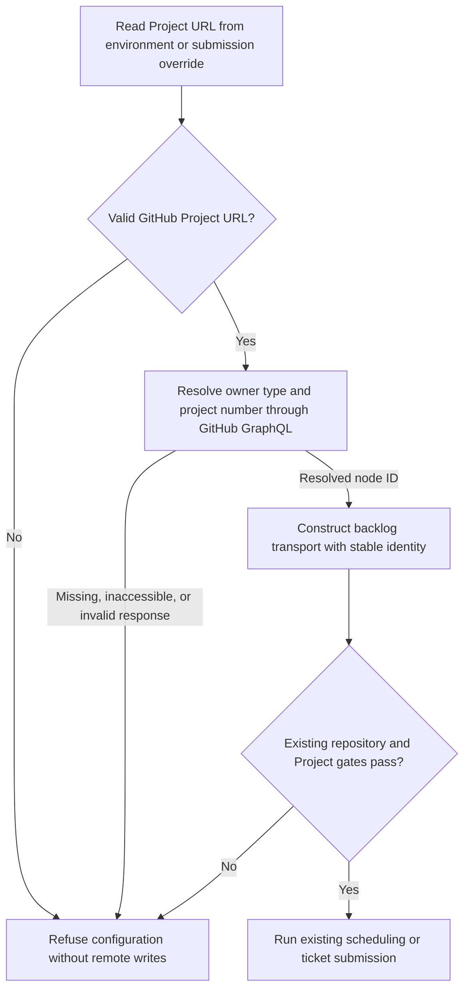

# Configure the private GitHub backlog with a Project URL

## 1. Human-review summary

### Summary
- Outcome: users paste their GitHub Project URL into `FORGE_BACKLOG_PROJECT_URL`; neither CLI requires users to discover an opaque Project node ID.
- Scope: resolve organization and personal Project v2 URLs in backlog infrastructure, migrate runner/submission configuration, and preserve internal node-ID identity and privacy gates.
- Readiness: Execution-ready, subject to the explicit intent assumptions below. This is a plan only; no runtime changes or verification results are claimed.

### Explain like I'm five
The runner and ticket submission command accept the same link a user opens in GitHub. At startup, the backlog transport reads that project's node ID through GitHub's API. Existing board reads, status writes, and submission recovery continue using that stable ID. Invalid links or inaccessible projects stop the invocation without remote writes; existing private-repository and private-board checks still apply.

### Target flow


### Affected code
```text
.
├── .env.example                         — replace the Project ID setting with URL examples
├── README.md                            — implemented configuration and migration instructions
├── AGENTS.md                            — implemented configuration ownership and invariants
├── docs/
│   ├── to-forge-tickets.md               — ticket-authoring configuration instructions
│   └── plans/                           — this planning artifact only; retain historical plans
└── factory/
    ├── main.ts                          — await resolved backlog construction
    ├── cli/                             — runner help, submission flags/runtime seam, CLI tests
    ├── features/
    │   └── submit-tickets/               — remove redundant Project override, preserve sidecar identity, tests
    └── infrastructure/
        └── github-backlog/               — URL parsing/resolution, async factory, contract comment, tests
```

### Assumptions
- This implements the previously proposed clean cutover: `FORGE_BACKLOG_PROJECT_URL` replaces `FORGE_BACKLOG_PROJECT_ID`; the old environment variable and raw-ID CLI inputs are not supported.
- Both organization-owned and personal Projects must work. GitHub Enterprise and classic Projects remain outside scope.
- Pasting a board view URL should work as well as pasting the project's base URL.

## 2. Scope and acceptance criteria

**In scope**
- `FORGE_BACKLOG_PROJECT_URL` and the submission CLI's existing `--project` flag accept supported GitHub Project v2 URLs.
- Parse the reference locally, then resolve it once per constructed backlog through the existing injectable HTTP seam.
- Migrate asynchronous construction and all affected callers/test fixtures directly.
- Keep internal `GitHubBacklog.projectId`, GraphQL mutations, and submission sidecars node-ID based.
- Maintain documentation once the behavior is implemented and verified.

**Out of scope**
- Accepting raw node IDs, bare numbers, owner/name shorthand, project titles, or alternate environment variables.
- New token types/scopes, automatic board creation, status-option creation, or changes to lifecycle/publication behavior.
- Changes to durable publication records, sidecar schema/version, dependency boundaries, harnesses, or historical plans.

**Acceptance criteria**
- AC1: a valid organization or personal Project URL resolves the correct node ID with `FORGE_BACKLOG_TOKEN`; subsequent board operations use that ID, not the URL or project number.
- AC2: invalid/missing URLs are rejected locally before HTTP. Missing/inaccessible projects, authentication failures, GraphQL errors, and malformed responses fail without remote writes and without leaking configured credentials.
- AC3: `tickets submit --project <url>` overrides the environment destination before resolution. Async construction failures produce the existing refusal report/exit code `2`; text and JSON output remain supported. `--dry-run` may resolve/read but never writes remotely.
- AC4: both `--help` paths return before environment loading, credentials, network, logger creation, and sandbox preflight. Existing private-resource and six-Status-option gates still prevent unauthorized writes.
- AC5: an existing submission sidecar for the same resolved Project ID remains valid and idempotent, including when a board view URL is used; another resolved Project ID is rejected. No durable schema migration is required.
- AC6: user-facing help/examples describe URL configuration and the breaking migration. No active code/configuration path reads `FORGE_BACKLOG_PROJECT_ID` or accepts raw IDs through `--project`.

## 3. Design decisions

- D1: use `FORGE_BACKLOG_PROJECT_URL`, and retain the flag name `--project` with a URL argument. Reason: a URL includes owner kind, owner, and project number without introducing another flag. Contract: no fallback to the old variable; an old-only configuration fails with guidance to replace it with a Project URL. If both variables exist, only the new setting participates in configuration.
- D2: parse and normalize inside `factory/infrastructure/github-backlog/`. Reason: reference interpretation and GitHub identity lookup are transport mechanisms, not feature policy. Contract: trim surrounding whitespace; require HTTPS, exact hostname `github.com`, no user info, and no non-default port. Accept `/orgs/<owner>/projects/<positive-number>` and `/users/<owner>/projects/<positive-number>`, optionally followed by `/views/<positive-number>`, with an optional trailing slash. Ignore query strings/fragments, which identify browser filtering rather than board identity. Reject other paths, missing owners, invalid numeric segments, and numbers outside GraphQL's positive signed 32-bit `Int` range. Do not echo rejected input verbatim: URLs can accidentally contain secrets.
- D3: make `createGitHubBacklog` return `Promise<GitHubBacklog>`, with configuration validation before its first HTTP request. Reason: the returned object can continue guaranteeing a concrete, immutable `projectId`; lazy resolution would spread asynchronous identity access into features and sidecars. Contract: query `organization(login: $owner) { projectV2(number: $number) { id } }` for `/orgs/` and `user(login: $owner) { projectV2(number: $number) { id } }` for `/users/`. Validate nullable owner/project responses and a nonempty ID. Send requests only to the fixed GitHub GraphQL endpoint, never the supplied browser URL. Use one resolution request per successful factory call, with no global cache or retries.
- D4: reuse the existing GraphQL exchange implementation for resolution. Reason: it already handles authentication, HTTP-200 GraphQL errors, schema validation, and credential-redacted diagnostics. Contract: minimally extract its request mechanics into a module-private helper used by both resolution and existing board operations, rather than adding a second HTTP implementation or a public generic transport abstraction. Preserve existing request headers and structured `BacklogHttpError`/`BacklogConfigurationError` behavior.
- D5: preserve `GitHubBacklog.projectId` as the resolved node ID. Reason: sidecar destination identity and board mutation arguments must not change when users paste a different view of the same Project. Contract: update the interface comment from configured ID to resolved ID; keep its type and downstream meaning unchanged. Resolution is not privacy authorization: existing fresh pre-write checks remain in place and must not reuse a cached privacy decision.
- D6: apply `--project` only at the submission composition boundary. Reason: `tickets-cli.ts` already applies environment overrides before constructing its transport. Contract: rename the parsed option to `projectUrl`, map it to `FORGE_BACKLOG_PROJECT_URL`, await construction inside the existing error boundary, and remove `SubmitTicketsInput.projectIdOverride` plus its callers. `readSubmissionGates` obtains Project identity exclusively from `backlog.projectId`; never pass the URL as a sidecar Project ID. Leave the unrelated repository override unchanged.
- D7: keep test injection explicit and async. Contract: change `TicketsRuntime.createBacklog` to return `Promise<GitHubBacklog>` and migrate injected factories directly, without a sync-or-async compatibility union. Validate local provider/configuration prerequisites before issuing the new lookup where the existing host permits it. Do not move either help early return.

## 4. Implementation steps

### Step 1: Implement URL parsing and async identity resolution
- **Code area:** `factory/infrastructure/github-backlog/`.
- **Change:** implement D1–D5. Validate all required local configuration before networking. Add module-private parsing/resolution and minimally share existing GraphQL request mechanics. Keep the public barrel narrow; do not export parsing solely to test it. Update the `GitHubBacklog.projectId` comment. Before changing exported contracts during implementation, inspect references through the available language server and migrate every consumer in Step 2. Add behavioral coverage through the factory for organization/personal URLs, board view normalization, malformed references, null owner/project, invalid response shapes, authorization, GraphQL errors, and credential redaction.
- **Depends on:** None.
- **Verification:** factory tests prove valid references produce the expected immutable ID; malformed references produce zero HTTP calls; inaccessible or malformed remote results produce zero writes and redacted structured failures (AC1–AC2). This step and Step 2 form one atomic code cutover; do not leave an async factory with unmigrated consumers.

### Step 2: Migrate hosts, submission overrides, and existing callers
- **Code area:** `factory/main.ts`, `factory/cli/`, `factory/features/submit-tickets/`, `factory/infrastructure/github-backlog/` tests.
- **Change:** await factory construction in the runner and submission composition. Implement D6–D7, including the async injected runtime seam. Replace runner/submission usage text. Update all real factory call sites and controlled-fetch fixtures to provide URLs and handle the resolution query. Update submission argument assertions and remove Project override inputs from feature tests. Preserve `projectId` in fake transports and sidecars because it remains the internal contract. Extend existing boundary/idempotence tests where useful; do not add source-text, wrapper-forwarding, or exact HTTP-call-count tests unrelated to behavior.
- **Depends on:** Step 1.
- **Verification:** run the affected colocated backlog, submission, and CLI tests using `npx tsx --test` with their actual discovered test paths. Exercise URL override precedence, async resolution rejection in JSON/text modes, dry-run zero writes, both help early returns, and same-ID/foreign-ID sidecar recovery (AC1–AC5). For lookup errors containing fixture credentials, assert those credentials never appear in returned reports. Confirm both resolved public-board and missing-Status-option cases still fail before writes.

### Step 3: Prove the complete configuration-to-operation path
- **Code area:** existing test seams in `factory/infrastructure/github-backlog/` and `factory/cli/`; disposable smoke driver, not retained.
- **Change:** run a bounded submission with a real temporary Markdown ticket/directory, the actual async backlog factory, and controlled GitHub HTTP responses. Resolve a Project URL, validate repository/board privacy and Status options, perform issue/board effects, and observe the emitted sidecar. Rerun unchanged input using a view URL for the same Project and prove idempotent destination recovery. Exercise a CLI URL override and a failed resolution. Use the actual logging/reporting path rather than replacing the full backlog with a fake. Remove disposable drivers/fixtures after the smoke run.
- **Depends on:** Step 2.
- **Verification:** observe resolved node IDs in board requests and sidecars, expected issue creation/status effects, unchanged rerun behavior, correct override destination, and exit `2` with zero mutation requests for failed resolution (AC1–AC5). Also execute a dry-run and observe zero mutation requests. This is controlled integration, not live GitHub evidence; no remote writes or real credentials are needed.

### Step 4: Document the implemented cutover and run repository checks
- **Code area:** `.env.example`, `README.md`, `AGENTS.md`, `docs/to-forge-tickets.md`, and changed CLI help in `factory/cli/`.
- **Change:** after smoke proof, replace active configuration instructions with URL examples for organization/personal boards and explain how to replace the old ID setting. Document view URL support, `--project` URL overrides, unchanged token/privacy/Status requirements, and that internal persisted identity remains a node ID. Review both operational root documents and update only affected statements. Preserve historical plans and avoid rewriting durable-ID terminology that remains correct. Search active source/docs/configuration for obsolete environment/flag semantics; distinguish deliberate old-input rejection fixtures and historical plan text from stale callers.
- **Depends on:** Step 3.
- **Verification:** run `npm run verify`, `npm run factory -- --help`, and `npm run tickets -- --help` from the repository root. Expect typecheck, recursive tests, and architecture validation to pass, and both help commands to describe URL configuration without credentials, Docker, or network (AC4, AC6).

## 5. End-to-end verification

- Execute the bounded actual-factory submission smoke described in Step 3: temporary authored ticket plus URL → owner-specific GraphQL resolution → existing privacy/status gates → issue and board effects → stable-ID sidecar → unchanged resubmission through a view URL. Observe requests, reports, and terminal files (AC1, AC3, AC5).
- Run rejected-input and rejected-resource scenarios through the factory/CLI boundary: local malformed URL makes no HTTP request; null project, HTTP/GraphQL failures, public resources, and incomplete Status options make no remote writes. Diagnostics redact fixture credentials; CLI refusal retains exit `2` and JSON/text report shape (AC2–AC4).
- Run repository checks and both real help commands from Step 4. Inspect the rendered help and active setup instructions for the URL-only contract (AC4, AC6).
- Do not run Docker, models, or live provider writes for this configuration-only cutover. Existing scheduling/publication tests remain regression coverage; no ticket-processing or publication behavior changes are planned.
- Observed verification for this document: repository configuration, host ordering, GraphQL mechanics, submission overrides, and sidecar guards were inspected. Implementation commands and runtime smoke scenarios above are planned, not executed.

## 6. Risks and open decisions

- **Risks:** URL-to-ID resolution adds one read-only network dependency before the runner constructs logging/preflights the sandbox. Keep help before all setup, preserve actionable redacted errors, and document this ordering rather than disguising resolution as local configuration.
- **Risks:** making the factory async affects every existing factory-based HTTP fixture and submission runtime injection. Migrate all references atomically and use full recursive tests/typecheck, not a narrowed discovery pattern.
- **Risks:** replacing the node ID with a URL in sidecars would break safe recovery. Preserve the stable-ID contract and exercise old sidecars against the newly resolved identity.
- **Risks:** loosening URL handling can admit unrelated paths or accidental credential-bearing URLs. Use the explicit accepted grammar, never fetch the supplied URL, and do not reflect rejected input verbatim.
- **Risks:** the clean cutover breaks old environment files and automation supplying raw IDs. Provide explicit migration instructions and a useful missing-URL error; no compatibility alias is planned.
- **Open decisions:** None. URL-only cutover and view URL support are stated assumptions, not independently confirmed requirements.
