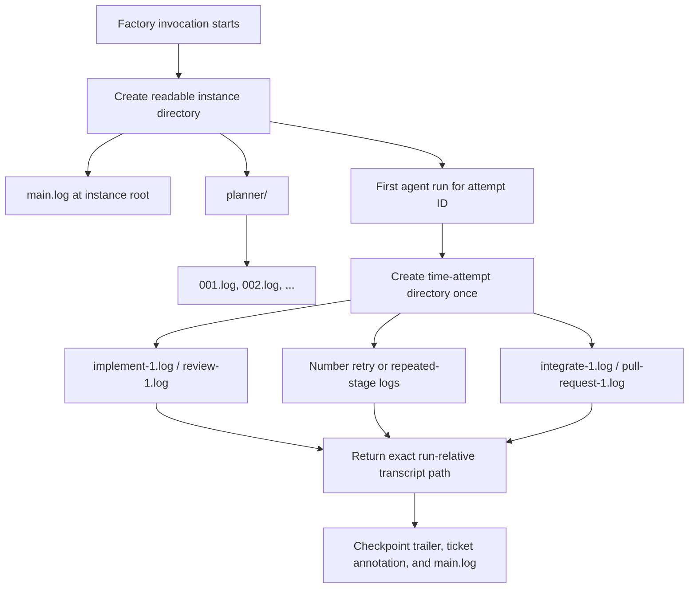

# Organize invocation logs by planner cycle and workflow attempt

## 1. Human-review summary

### Summary
- Outcome: Each daemon invocation gets a short, readable `.logs/<startup-time>-<short-id>/` directory; planner runs live under `planner/`, and implementation through publication logs live in sortable `<first-log-time>-<attempt-id>/` directories with short stage filenames.
- Scope: Change log path allocation, propagate exact relative transcript references through successful stage results, update checkpoint/ticket/main-log references, cover retries and concurrent attempts, and align operational documentation. Existing `.logs/` contents are left untouched.
- Readiness: Execution-ready.

### Explain like I'm five

The logger creates one readable folder when the factory starts. Planner transcripts go into that folder's `planner/` directory. Every workflow attempt gets another directory named from the time its first agent run starts and its existing attempt ID, so implementation, review, integration, and pull-request transcripts can use short names inside it. When a checkpoint records its transcript, it records the exact path relative to the invocation folder rather than only a filename.

### Target flow



### Affected code

```text
.
├── factory/
│   ├── infrastructure/
│   │   ├── logging/                 — allocate instance, planner, attempt, and numbered stage paths; test path and reference invariants
│   │   └── agent-runtime/           — request a scoped log target and return the allocated transcript reference
│   └── features/
│       ├── plan-tickets/            — route each planner cycle into planner/
│       ├── implement-ticket/        — route runs by attempt and return the accepted implementation transcript
│       ├── review-ticket/           — route runs by attempt and return the accepted review transcript
│       ├── integrate-tickets/       — route runs by integration attempt and return the accepted integration transcript
│       ├── publish-pull-request/    — route content runs by publication attempt and expose the transcript reference
│       ├── ticket-processing/       — carry exact transcript references into commits, traces, and annotations
│       └── tickets/                 — store run-relative transcript paths rather than basename-only values
├── docs/
│   └── plans/                       — this implementation plan
├── README.md                        — document the new layout and tracing commands
└── AGENTS.md                        — align repository log/reference invariants with the implementation
```

### Assumptions
- `<instance>` means one `factory` process invocation, matching the current `InvocationLogger` lifetime.
- The selected readable instance format is UTC `YYYY-MM-DD_HH-mm-ss-<6-hex-id>`; milliseconds and process IDs are intentionally omitted.
- `<timestamp>-<guid>` means UTC `YYYY-MM-DD_HH-mm-ss-<attempt-id>`, using the existing six-hex workflow attempt ID rather than introducing a second attempt identifier.
- The attempt timestamp is when that attempt's first agent transcript is allocated. This avoids adding logging timestamps to workspace reservation contracts.
- Existing log directories and historical checkpoint/ticket references are not renamed or migrated.

## 2. Scope and acceptance criteria

**In scope**
- Create collision-safe, sortable invocation directories with second-resolution UTC timestamps and random six-hex suffixes.
- Keep the redacted append-only `main.log` at the invocation root.
- Store planner cycles as `planner/001.log`, `planner/002.log`, and so on.
- Store all non-planner agent runs under the directory assigned to their existing attempt ID. A single-ticket attempt therefore keeps implementation, review, and publication together; an integration workspace keeps integration and grouped publication together.
- Allocate a distinct numbered file for every invocation of a stage, including missing-handoff retries and repeated integration passes, without overwriting an earlier transcript.
- Record the exact invocation-relative transcript path selected for the successful agent run in checkpoint commits, `main.log`, and ticket lifecycle annotations.
- Validate every caller-supplied path segment and reject absolute paths, separators, traversal, empty values, and unsupported characters before filesystem access.

**Out of scope**
- Moving or rewriting existing `.logs/` directories, retained workspaces, ticket history, or existing commits.
- Changing ticket attempt IDs, workspace names, branch names, stage retry limits, log contents, redaction, or agent scheduling.
- Adding a CLI flag or persistent configuration for log naming.
- Splitting `main.log` by attempt or changing its line-oriented record format beyond allowing `agent-log=` to contain an invocation-relative path.

**Acceptance criteria**
- AC1: A new logger creates exactly one `.logs/YYYY-MM-DD_HH-mm-ss-xxxxxx/` invocation directory and writes `main.log` at its root; simultaneous creations cannot select the same directory.
- AC2: Planner cycles produce ordered files under `<instance>/planner/` and never share a file with workflow stages.
- AC3: The first run for an attempt creates one `<first-log-time>-<attempt-id>/` directory, and all later runs carrying that attempt ID reuse it.
- AC4: Each stage invocation receives a new numbered transcript file; retries and repeated integration runs preserve every earlier file.
- AC5: A successful implementation, review, integration, or pull-request-content run returns its exact invocation-relative path, and every resulting checkpoint trailer, ticket annotation, and `main.log` checkpoint/content record uses that same path.
- AC6: Parallel attempts and parallel log allocation produce unique files and stable attempt-directory mappings without races or cross-attempt writes.
- AC7: Unsafe path targets fail before creating or writing outside the invocation directory, while credential redaction and human-readable stream contents remain unchanged.
- AC8: Operational documentation accurately shows the new directory layout and commands for locating a transcript from `main.log` or a checkpoint trailer.

## 3. Design decisions

- D1: Use `YYYY-MM-DD_HH-mm-ss-<six random hex>` for the invocation directory. Reason: It preserves chronological scanning while removing milliseconds and the long process ID identified as noise. Contract: Creation uses exclusive directory creation with bounded regeneration on collision; the random suffix is identity only and is not a process ID.
- D2: Give the logger a generic scoped log-target contract rather than parsing feature-specific strings. Reason: Logging infrastructure must not infer ticket, planner, or integration semantics from filenames. Contract: Callers request either a fixed validated directory such as `planner` or a timestamped scope keyed by a validated stable ID such as an attempt ID, plus a validated short stage name.
- D3: Lazily bind each timestamped scope ID to one directory on its first allocation. Reason: The existing attempt ID is available to every stage, while attempt-start timestamps are not part of stage inputs. Contract: The binding is immutable for the invocation; concurrent first allocations for one ID converge on one directory, and distinct IDs cannot share a directory.
- D4: Number files per scope and stage from `1`, including the first run (`implement-1.log`, `review-1.log`, `integrate-1.log`, `pull-request-1.log`). Planner cycles use zero-padded cycle names (`001.log`). Reason: Consistent numbering makes retries explicit and guarantees no transcript overwrite. Contract: Allocation is atomic within an invocation logger and remains correct under the global parallel job pool.
- D5: Return the allocated invocation-relative transcript path from `AgentRunner` and carry it through each successful stage outcome. Reason: Looking up a mutable “latest” path after a run is race-prone and can point at the wrong retry or repeated integration pass. Contract: The path uses `/` separators, is relative to `InvocationLogger.runDir`, and is the single value used for the related checkpoint, trace, and ticket annotation.
- D6: Replace basename-specific domain fields and APIs with transcript-reference naming in one clean cutover. Reason: Nested logs make a basename ambiguous. Contract: `Factory-Agent-Log`, ticket `Agent log`, and `main.log` `agent-log=` retain their existing labels but contain the run-relative path; no compatibility alias or duplicate basename field is added.
- D7: Keep `main.log` at the invocation root and keep old logs immutable. Reason: One invocation-wide diagnostic stream remains easy to locate, and historical artifacts may already be referenced by retained tickets and commits. Contract: Readers must accept historical basename-only references as data; only newly produced records use nested relative paths.

## 4. Implementation steps

### Step 1: Implement collision-safe hierarchical path allocation
- **Code area:** `factory/infrastructure/logging/invocation-log.ts`, `factory/infrastructure/logging/invocation-log.test.ts`.
- **Change:** Implement D1–D4 in `InvocationLogger`. Replace the flat `agentLogPath(name)`/`agentLogBasename(name)` pair with an allocation API that accepts a generic fixed or timestamped scope and stage name, creates required directories, atomically assigns monotonically numbered files, and returns both the absolute write path and normalized invocation-relative reference. Keep `record` and redaction behavior unchanged except for renaming the optional checkpoint field from basename-oriented terminology to transcript-reference terminology. Add deterministic clock/random seams only if required to test naming and collisions without timing assumptions. Validate path segments before any `resolve`/filesystem operation.
- **Depends on:** None.
- **Verification:** Run `npm test -- --test-name-pattern='log'`. Assert the instance pattern and root `main.log` (AC1), planner placement (AC2), stable timestamped-scope reuse (AC3), repeated and concurrent allocation uniqueness (AC4, AC6), traversal rejection (AC7), and unchanged credential redaction.

### Step 2: Make the runtime return the exact allocated transcript
- **Code area:** `factory/infrastructure/agent-runtime/agent-runtime.ts` and its existing colocated tests.
- **Change:** Replace `AgentRunRequest.logName` with the generic scoped target from D2. Allocate a fresh path immediately before each Sandcastle run, pass only its absolute path to Sandcastle, append handoff statuses to that same path, and add the normalized relative reference to `AgentRunResult` after an accepted handoff. Preserve cleanup and all current missing/invalid/transport handoff behavior. Ensure a failed or missing-handoff run consumes its numbered file so the next invocation cannot overwrite it.
- **Depends on:** Step 1.
- **Verification:** Exercise a controlled runner sequence with a missing handoff followed by an accepted handoff. Expect two distinct numbered files, retained status lines in the first, and a result reference to the second (AC4, AC5, AC7).

### Step 3: Route planner and stage runs into their owning scopes
- **Code area:** `factory/features/plan-tickets/`, `factory/features/implement-ticket/`, `factory/features/review-ticket/`, `factory/features/integrate-tickets/`, `factory/features/publish-pull-request/` and their colocated tests.
- **Change:** Planner requests use the fixed `planner` scope and their cycle number. Implementation and review use the ticket attempt ID with short `implement`/`review` stage names. Integration uses its integration workspace attempt ID; pull-request content uses the publication attempt ID, which is the selected ticket or integration workspace attempt. Extend successful stage outcomes/callbacks to carry D5's transcript reference. Preserve the three single-iteration loops and all stage-owned handoff contracts.
- **Depends on:** Step 2.
- **Verification:** Run focused tests for the five feature folders. Capture each `AgentRunRequest` and assert its scope/stage target; simulate a successful runner result and assert the identical transcript reference leaves the feature outcome. For retrying features, verify separate runtime calls are made without asserting incidental prompt or forwarding details (AC2–AC5).

### Step 4: Persist exact relative references at workflow boundaries
- **Code area:** `factory/features/ticket-processing/execute-attempt.ts`, `factory/features/ticket-processing/integrate-candidates.ts`, `factory/features/ticket-processing/dependency-cycle.ts`, `factory/features/ticket-processing/stage-commit.ts`, related tests, `factory/features/tickets/ticket-lifecycle.ts`, `factory/features/tickets/ticket-lifecycle.test.ts`.
- **Change:** Implement D5–D7 end to end. Carry each stage outcome's transcript reference into checkpoint creation instead of reconstructing a basename. Use the integration result's reference for each integration commit. Have pull-request content completion record the content run's returned reference. Rename internal `agentLogBasename` fields to `agentLogReference` (or equivalent precise naming), while retaining the external `Factory-Agent-Log`, `Agent log`, and `agent-log=` labels. Keep references relative; never place `.logs`, the absolute factory root, or credentials in commits/tickets.
- **Depends on:** Step 3.
- **Verification:** Run focused ticket-processing, stage-commit, and ticket-lifecycle tests. For implementation, review, integration, and pull-request content, assert the value emitted by the controlled runner is exactly the value in the corresponding commit trailer, ticket section, and `main.log` record; assert a nested path rather than only a filename (AC5–AC7).

### Step 5: Align operational documentation
- **Code area:** `README.md`, `AGENTS.md`.
- **Change:** Document the target tree, UTC naming formats, retry numbering, root `main.log`, and run-relative `Factory-Agent-Log` contract. Replace flat `.logs/*/main.log` and transcript examples with commands matching the extra instance/attempt depth. Update repository invariants from “basename” to “invocation-relative path” without changing unrelated workflow or publication guidance.
- **Depends on:** Step 4.
- **Verification:** Follow the README trace example against the smoke-run output from Step 6 and locate the referenced transcript without guessing a filename (AC8).

### Step 6: Verify the complete layout and clean temporary evidence
- **Code area:** Repository root and temporary directories outside retained `.logs/`/`.workspaces/` artifacts.
- **Change:** Run a disposable logger/runtime smoke that allocates two planner cycles, one ticket attempt with an implementation retry and review, and one integration/publication attempt. Write representative checkpoint records, then inspect the resulting tree and resolve every recorded relative reference. Remove only the disposable smoke driver and fixture; do not alter retained user logs or workspaces.
- **Depends on:** Steps 1–5.
- **Verification:** Observe one readable instance directory, root `main.log`, `planner/001.log` and `002.log`, stable per-attempt directories, distinct numbered retry files, and resolvable matching references (AC1–AC8). Then run `npm run verify` and `npm run factory -- --help`; both must succeed, and help must still return without creating logs or requiring credentials/Docker.

## 5. End-to-end verification

- In a temporary factory root, start one logger and execute controlled planner cycles 1 and 2; verify the two planner files are ordered beneath `planner/` and `main.log` remains at the instance root (AC1, AC2).
- Run two attempt scopes concurrently. For one, force a missing implementation handoff before a successful implementation and then a review; for the other, run integration and pull-request content. Verify one directory per attempt ID, all expected numbered stage files, no overwritten transcript, and no cross-attempt content (AC3, AC4, AC6).
- Build representative implementation/review/integration checkpoints and a pull-request-content trace from the successful results. For each, join the recorded invocation-relative reference to `runDir` and read the exact successful transcript; verify no absolute factory path or secret appears in records, annotations, or commit messages (AC5, AC7).
- Attempt scopes or stage names containing `/`, `..`, an absolute path, an empty segment, and platform separators; each must fail before a file appears outside the instance directory (AC7).
- Execute `npm run verify` and `npm run factory -- --help`, then follow the updated README commands against disposable smoke output (AC8).

## 6. Risks and open decisions

- **Risks:** Existing stage loops currently reuse a flat `logName`; changing only the directory shape would continue overwriting retries. D4 requires allocation per actual `AgentRunner` call. Integration can run more than once in one integration workspace, so numbering must be per scope/stage rather than hard-coded by feature. Nested references also cross durable commit and ticket boundaries; D5 avoids races by returning the exact allocation instead of reconstructing or querying it later. Second-resolution names can collide, so both instance and attempt-directory creation require suffix identity and collision-safe allocation.
- **Open decisions:** None.
