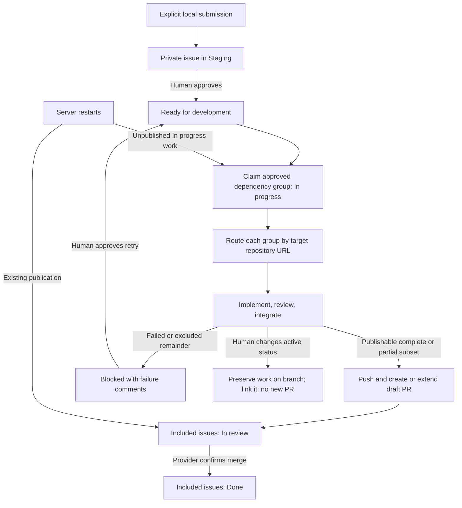

# Run Forge from a private GitHub backlog with explicit local ticket submission

## 1. Human-review summary

### Summary
- Outcome: Submit locally authored Markdown tickets to a separate private GitHub backlog, approve them by status, and let the server-side factory build against GitHub or Azure DevOps repositories in the same invocation. Follow progress, failures, branches, and pull requests from the issues.
- Scope: Client submission, authoritative backlog status, multi-provider routing, dependency-group execution and partial publication, human-controlled retry, safe work preservation after status changes, and restart-safe publication tracking. No ADO work items or client-side factory execution.
- Readiness: Execution-ready with the selected design assumptions below. Deployment requires a private backlog repository and private GitHub Project, appropriate credentials, and permission to place work-ticket content there. Those resources are not created by this planning change.

### Explain like I'm five

The client uploads selected ticket files, but uploading does not start development. GitHub holds the authoritative queue, and moving a ticket to Ready authorizes the server to work on it. The server changes statuses and posts useful evidence as work proceeds. A draft PR means In review, not Done; merging that PR completes its included issues. Failed work waits for a human to approve another attempt. Restarting the server starts unfinished work afresh without forgetting PRs already published.

### Target flow



### Affected code

All new filenames and folders below are proposed. Tests remain colocated with their owning implementation.

```text
.
├── factory/                             — main.ts server composition; proposed tickets-main.ts client composition
│   ├── cli/                             — server backlog configuration; explicit ticket submission command and help
│   ├── features/
│   │   ├── tickets/                     — Markdown/issue identity, metadata parsing, fingerprints and local evidence
│   │   ├── submit-tickets/ (new)        — staging-only issue create/update capability
│   │   ├── ticket-processing/          — backlog discovery, claims, status policy, publication ledger and restart handling
│   │   └── publish-pull-request/       — explicit side-effect guards and publication intent/result callbacks
│   ├── infrastructure/
│   │   ├── github-backlog/ (new)        — issue/Project API operations, pagination, private-resource checks
│   │   ├── git-provider/               — URL routing, provider construction and exact PR lookup after uncertain create
│   │   └── logging/                    — aggregate-secret redaction for logs and outbound diagnostics
│   └── shared/                         — pure multi-secret redaction only if needed by existing callers
├── docs/
│   └── plans/                          — this plan only; leave historical plans unchanged
├── package.json / package-lock.json    — client command; lockfile only if dependencies actually change
├── .env.example / .gitignore           — backlog/provider configuration and ignored runtime state
├── .dependency-cruiser.cjs             — new host entry-point and submission-feature boundary enforcement
├── README.md                          — implemented setup, submission, statuses, routing and restart operation
└── AGENTS.md                          — implemented ownership and changed lifecycle/continuation contracts
```

### Assumptions
- Choose a private GitHub Projects v2 board and its single-select Status field as the sole status authority. The user wants easy movement and would like a board, but did not require one; this is a selected implementation choice, not an additional user requirement. Do not maintain a competing status-label workflow.
- Deliver the explicit command as a normal CLI callable from an oh-my-pi shell tool/terminal. A bespoke harness extension is not necessary for the agreed workflow and is outside this plan.
- One server process owns this backlog. Multiple simultaneous clients/processes writing the same ticket are not a supported coordination model.
- “All issues in the tree” means all approved, unfinished members selected for that delivery group, not Staging issues or already published/merged ancestors. Approval is per issue; a connected Staging issue must never be implicitly authorized.
- Restart means the server and its persistent disk survive while the process is replaced. Unfinished agent/workspace state is not resumed; minimal publication and status-settlement evidence does survive.
- On an external status change, let the current agent call return, then preserve work at a safe boundary; do not invent a new process-kill/cancellation protocol. Do not launch another work stage after observing the change.

## 2. Scope and acceptance criteria

**In scope**
- A separate private issue repository and private Project, independent from the Forge source repository and target code repositories.
- Explicit local-file submission, repeatable identity, staging-only updates, and usability from oh-my-pi without Docker, SSH push access, or server credentials on the client.
- Server-side remote discovery, issue comments and statuses, URL-based Git provider selection, dependency-aware scheduling, partial PR publication, and merged-PR completion.
- Bounded complete attempts followed by Blocked; retry requires a human status change. Existing three-call stage loops and global agent-job bounds remain.
- Branch-only work preservation when execution authorization changes; fresh attempts after restart; durable publication facts sufficient to avoid blind republishing.
- Migration of affected callers, behavior tests, setup instructions, and architectural rules when implementation lands.

**Out of scope**
- ADO Boards tickets, automatic importers for other ticket sources, file watchers, automatic upload, a custom web UI, or bidirectional file synchronization.
- Native oh-my-pi extension packaging, a published npm package, agent-session recovery, distributed locks, multiple server workers, or a general durable workflow engine.
- Automatically merging PRs, bypassing policies, marking drafts ready, force-pushing, deleting branches/workspaces, or changing repository settings.
- Migrating old local lifecycle files automatically, exposing retained artifacts publicly, or modifying unrelated runtime skills, samples, proof scenarios, and historical plans.

**Acceptance criteria**
- AC1: Submitting one or more valid files creates one private issue per stable ticket ID, adds each to the configured private Project in Staging, and prints issue URLs and per-file outcomes. No agent job starts from submission.
- AC2: Repeated submission updates the same issue only when its current status is Staging. Non-Staging or unknown/missing status refuses mutation; returning to Staging permits update again. Duplicate IDs are reported, not guessed around.
- AC3: Ready authorizes execution. The factory marks all approved unfinished members of a selected group In progress before starting its agents, without promoting Staging, Blocked, In review, or Done members. Invalid metadata/dependencies produce visible diagnostics rather than a silent idle loop.
- AC4: A single invocation processes independent GitHub and ADO groups using their URL-selected adapters and credentials, under one global job limit. Unsupported URLs, incompatible dependency repositories/bases, or unavailable target credentials block only affected work.
- AC5: Preserve existing dependency baselines, integration review, shared PRs and partial publication. Only the exact included issues move In progress → In review after a successful push and draft PR result; failed/excluded unfinished issues move to Blocked. No issue becomes Done merely because a PR exists.
- AC6: Confirmed merge moves the exact included issues to Done and closes them as completed. An open or closed-unmerged PR does not complete issues. Dependency continuation still requires the existing merged-delta/base verification.
- AC7: Exhausted attempt budgets and nonretryable failures post credential-redacted failure evidence and block affected issues. No automatic next-cycle retry occurs until the human sets Ready. Blocked descendants do not run.
- AC8: If an active issue leaves the factory-owned In progress status, no subsequent work stage or new PR is authorized after detection. Preserve available work in a non-force-pushed target-repository branch, comment its URL/SHA and unreviewed status, and leave the human-selected status unchanged. Preservation failures are explicit and retained, never reported as success.
- AC9: Restart automatically makes unpublished In progress tickets eligible for fresh retained workspaces and new attempts. Staging/Blocked/In review issues are not executed. Existing PRs remain tracked through merge; a crash around publication or settlement does not cause blind duplicate PR creation.
- AC10: Issue feedback includes meaningful stage transitions, blockers, failed-attempt logs, checkpoint/branch/PR references, and exact included-ticket membership. Comments remain bounded, idempotent on replay, and redact all configured raw and derived credentials.
- AC11: Help works before environment/credential/Docker work. Client submission runs without sandbox preflight; server preflight and existing agent handoff/checkpoint/security contracts remain intact. Public/mismatched backlog resources fail closed.

## 3. Design decisions

- D1: **GitHub Issues contain tickets; a private Project owns status.** Configure `FORGE_BACKLOG_REPOSITORY=owner/repository` and `FORGE_BACKLOG_PROJECT_ID=<node-id>`; use `FORGE_BACKLOG_TOKEN` independently from code-provider tokens. Resolve the Status field and six options at startup: Staging, Ready for development, In progress, In review, Done, Blocked. These are configured workflow names, not assumed GitHub defaults. Setup creates/configures the resources manually; runtime validates privacy, repository identity, issue access, Project ownership/access and option IDs. Revalidate privacy before outbound writes; missing permissions or unknown statuses never mean Ready. REST handles issues/comments; GraphQL handles Project discovery/items/field values. Paginate all relevant collections. Do not enable Project automations that compete with runner statuses.

- D2: **Stable ticket IDs, no local mapping database.** Reuse required front matter (`id`, `name`, `repository`, `baseBranch`, `dependsOnTickets`) and put the complete authored Markdown in the issue body. Scope ID uniqueness to the backlog repository. Resolve existing tickets using repository issues and validated bodies, not filename or issue title and not eventually consistent search alone. Display the derived title as the issue title. Issue node ID/number identifies remote operations; the declared ticket ID identifies dependencies. Runner comments hold lifecycle evidence, never append operational records into the authored body. Preserve source/requirements hash semantics for authored content. Parse Markdown independently of filesystem loading so client files and server issue bodies share validation. Agents receive materialized snapshots, not credentials or backlog mutation tools.

- D3: **Explicit batch command with staging-only updates.** Proposed command: `npm run tickets -- submit <file.md> [more.md ...]`, implemented by `factory/tickets-main.ts` and `features/submit-tickets/index.ts`. Client uses explicitly configured environment values and never needs the server's `.env` or target-provider credentials. Validate the whole batch locally before remote writes; report partial remote success per file with a nonzero exit on any failure. Preserve order for output, not dependency scheduling. For create, recover uncertain issue creation by exact ID lookup before retry; finish missing Project attachment/Staging assignment on resubmission rather than creating a second issue. An issue with incomplete setup is not executable. For update, read status/body immediately before mutation, refuse known concurrent edits, and recheck after writing. Never automatically set an existing non-Staging issue back to Staging. GitHub offers no transaction across issue-body and Project-status updates; document the narrow concurrent-edit limitation and do not claim atomic compare-and-swap.

- D4: **Clean server cutover to the remote queue.** Replace `--tickets-dir` as the server queue input rather than introducing two competing execution authorities. Local Markdown stays the authoring format and a retained per-attempt input artifact; existing local ticket directories and lifecycle files are left untouched. `ticket-processing` discovers remote tickets and owns claim/transition/settlement policy. `tickets` remains the leaf owning identity/parsing and local evidence, with no Project or coordinator imports. `github-backlog` exposes mechanical operations/data and credential-redacted HTTP errors, not scheduling policy. `submit-tickets` owns ingestion policy and may consume only the public `tickets/index.ts` feature surface. Stages remain unaware of Projects/issues and receive small stage-owned inputs.

- D5: **Route through configured provider instances, not global selection.** Replace `GIT_PROVIDER` and the singular `ProcessConfig.gitProvider` with a configured provider set/resolver constructed once in `main.ts`. Recognize only existing canonical GitHub and Azure SSH forms; each selected adapter still performs canonical validation. Keep `GITHUB_TOKEN` and `AZURE_DEVOPS_PAT` for target publication; backlog-only client validation uses URL syntax without requiring either. Construct whichever target adapters have credentials; encountering an unavailable provider blocks that ticket with a clear reason, not unrelated groups. Within an attempt, pass one resolved provider to workspace/publication operations; never expose the whole registry as a generic stage context. Aggregate backlog token, all provider secrets and Azure-derived Basic values for redaction and commit/PR-content secret rejection across every group. Preserve REST/API-version/authentication, SSH transport and squash-preference contracts.

- D6: **Claim approved groups, then schedule the existing dependency-ready queue.** Read all managed issues needed to build the dependency graph, including satisfied/published ancestors, but only Ready or restart-eligible In progress members may begin execution. Group membership is based on declared dependencies, not GitHub sub-issue UI nesting. A Ready ticket whose prerequisite is Staging, missing, invalid or Blocked cannot run; report and block affected dependants, without changing the prerequisite's human status. Before agents start, re-read selected members and mark approved unfinished members In progress. If claiming only partly succeeds, launch no jobs; reconcile the partial claim before a later cycle. No multi-issue atomic claim is promised. Keep the bounded coordinator queue, planner selection contract, retained component identity within the invocation and 10-second idle polling. Poll merge/status settlement even when no executable tickets exist.

- D7: **Status follows publication membership, not the whole connected component.** A successful whole-tree publication puts all included issues In review together logically, using recoverable per-issue writes. Partial publication puts only its dependency-closed included subset In review; exhausted, excluded or unusable remainder is Blocked with reasons. Keep reviewed-subset fallback, unchanged-draft extension and exact provider identity validation. Extend a draft only when its included issue requirements/statuses still authorize it; unrelated human changes must not be overwritten. Later approved descendants may use verified remote published baselines after restart, not unverified abandoned workspaces. On merge, close and set Done only for exact recorded members and matching authored requirements. Provider-confirmed merge completes issues; exact delta/base validation separately gates using that merge as a dependency baseline. An unmerged closed/deleted/mismatched PR blocks affected members with evidence rather than silently completing or replaying them.

- D8: **Human-controlled retry after the existing budget.** Retain `--ticket-attempts-per-cycle` default 3 as the budget of fresh complete attempts per approval episode, and retain the three single-iteration calls within implementation/review/integration. Exhaustion becomes remote Blocked instead of invocation-local retryable work that retries every cycle. Durable checkpoint/trace ambiguity remains immediate failure; it does not cause another commit in that workspace. Human Ready resets the complete-attempt budget and allocates fresh workspaces, even if historical attempts exist. Requirements changed before a new authorized attempt are a new snapshot; never adopt checkpoints produced from a different hash. Changes detected during active work suppress its publication and explain the mismatch.

- D9: **Preserve, do not publish, when authorization changes.** Re-read authoritative issue status/requirements before stage dispatch and at side-effect boundaries, including immediately before push/create/update. Use narrow async guard callbacks in publication inputs; the publication feature does not import coordinator policy. When any candidate member leaves its owned status, stop that candidate's normal path; other independent approved candidates may continue. Let an already-running agent call finish, but do not start another call, review or conflict-repair run after detecting withdrawal. Preserve each affected attempt on its unique retained branch with non-force push and a browser-facing branch link/SHA comment, explicitly marked unreviewed and not a PR. If dirty but conflict-free, the coordinator makes a distinct work-preservation commit after branch/HEAD/secret checks; this is not a successful stage checkpoint and must not forge success trailers. If there are unresolved merges, do not invent a resolution or commit conflicts: push the last valid committed head when available, report that uncommitted/conflicted work remains only in the retained workspace, and report preservation as incomplete. Keep the external status. Check again after remote effects; a status change racing an already accepted provider request is reported rather than hidden or 'undone' through destructive operations.

- D10: **Fresh execution plus a minimal durable publication ledger.** Keep graph/agent scheduling and reusable unfinished checkpoints invocation-local. Add coordinator-owned ignored `.factory-state/` storage, with atomic versioned records outside ticket workspaces, for external side-effect intents/results and pending status/comment settlement only. This is an explicit narrow change to the current invocation-only publication contract. Record repository/provider, backlog issue IDs, ticket IDs/requirements hashes, base, branch, exact head SHA, title/body, included membership, merge preference and operation identity before publication side effects; record returned PR identity before issue settlement. Keep exact publication-delta verification inputs or immutable Git references needed by `verifyMergedPublication`, not transient in-memory candidate objects. On restart, first reconcile these facts against provider state, settle known published issues and resume PR monitoring; only then retry unpublished In progress work in fresh workspaces. For uncertain create, add provider-neutral exact PR lookup by repository/head/base (including closed/merged results), validate the complete identity and adopt only an exact match. Ambiguous evidence blocks rather than blindly creates. No automatic recovery of old dirty work or continuation from its checkpoints. Persist incomplete issue/comment settlement for replay without repeating code publication. Known unambiguous unfinished pre-publication work does not need manual reconciliation just because an old attempt exists.

- D11: **Useful, bounded issue feedback.** Post one start comment and meaningful stage/result comments, not streamed tool events. Failure comments include stage, attempt, redacted command diagnostics and the relevant existing human-readable failed-stage log; split long logs into numbered comments below provider limits and do not include raw events/thinking. Identify each comment by a runner-owned operation key, verify the authenticated writer when finding prior comments, and avoid duplicate comments on restart. Record local log references for operators without treating server paths as client-accessible links. Never upload `.env`, arbitrary repository files or unrelated logs. Feed all configured secrets into both local and outbound redaction. Comment/status transport failures retain pending settlement; do not turn into implementation retries or republish successful work.

- D12: **Preserve existing unrelated contracts and apply docs at implementation time.** `--help` remains independent from environment, credentials and Docker. Server uses the configured harness, immutable handoff transport, one global lease pool, agent-no-commit rule, runner-owned successful checkpoint contract and provider safety rules. Client does no sandbox preflight. Extend architecture enforcement for both composition roots and the new ingestion feature without weakening existing feature isolation, unresolved-import or cycle checks. No operational documentation changes accompany this planning-only commit. When the implementation is verified, update both README and AGENTS to replace the one-provider, local-queue, invocation-only-publication and publish-means-done descriptions. Existing log-layout work is independent: consume the actual logger's returned references, do not overwrite or restyle it.

## 4. Implementation steps

### Step 1: Establish shared ticket identity and explicit remote contracts
- **Code area:** `factory/features/tickets/`, `factory/infrastructure/github-backlog/` (new), `factory/features/ticket-processing/`.
- **Change:** Extract source parsing from `loadTicket` without changing YAML/default/hash semantics. Define remote issue identity, authored snapshot and raw Project-status records; keep workflow enums/transition policy in the owning features, transport DTOs in infrastructure. Define stable operation keys and the versioned publication-intent/result record from D10. Inspect exported references with language tooling and migrate direct callers; no compatibility barrels or duplicate parsers.
- **Depends on:** None.
- **Verification:** Colocated tests for equivalent file/issue parsing, malformed metadata, duplicate/self IDs, full-source versus requirements hashes, and status/record decoding boundaries. AC1–AC3, AC9.

### Step 2: Implement private GitHub backlog transport
- **Code area:** `factory/infrastructure/github-backlog/`.
- **Change:** Implement authenticated issue list/read/create/update/comment/close and Project item/status operations using a fetch seam; paginate all endpoints. Validate private repository/Project, resolve field/option IDs and detect missing membership/options. Keep HTTP failures structured and redacted; expose issue revisions for conflict detection. Implement exact-ID discovery and deduplicated comment retrieval without using search as a uniqueness guarantee. Verify current GitHub API permission and Projects behavior against official documentation during implementation.
- **Depends on:** Step 1; private resource configuration for live verification.
- **Verification:** HTTP-seam tests cover multi-page lists, private/public resources, inaccessible Project, unknown status, duplicate IDs, ambiguous create response and oversized comments. An authorized disposable private repository/Project smoke must create/read/move an issue and verify both privacy settings; no remote write without explicit authorization. AC1, AC2, AC10, AC11.

### Step 3: Deliver the explicit local submission command
- **Code area:** `factory/tickets-main.ts` (new), `factory/cli/`, `factory/features/submit-tickets/` (new), `package.json`, `.dependency-cruiser.cjs`.
- **Change:** Implement D3 create/update orchestration and the proposed `tickets` script. Read only explicit files and client backlog configuration. Print created/updated/refused/failed outcomes with URLs; exit nonzero on partial failure. No shell-glob expansion inside the program, background upload, target-provider access or Docker initialization. Add the new host and ingestion boundaries to architecture rules.
- **Depends on:** Steps 1–2.
- **Verification:** Run the actual command with temporary Markdown files and controlled HTTP: create, resubmit/update, refuse Ready, return to Staging/update, interrupted Project attachment, duplicate ID and partial batch failure. Run `npm run tickets -- --help` with no credentials/Docker. Exercise the command from an oh-my-pi shell when available; otherwise explicitly report that UI integration was not observed. Demonstrate architecture rejection of a temporary illegal cross-feature type-only deep import and feature-to-client-host import, then remove fixtures. AC1, AC2, AC11.

### Step 4: Support multiple code providers and aggregate secret protection
- **Code area:** `factory/main.ts`, `factory/infrastructure/git-provider/`, `factory/infrastructure/logging/`, `factory/shared/`, `factory/features/tickets/`, `factory/features/ticket-processing/`, `factory/features/publish-pull-request/`, `.env.example`.
- **Change:** Implement D5, replacing the global provider selector and resolving a validated provider per ticket/group. Update all consumers directly, including parsing, workspaces, commits, publication and reconciliation. Pass the complete secret set to every diagnostic/commit/content boundary; do not rely on only the currently selected provider's token. Keep target credentials off the client and out of agent environments.
- **Depends on:** Step 1.
- **Verification:** Same-invocation tests route GitHub and ADO fixtures to distinct HTTP adapters and preserve global concurrency bounds. Verify missing ADO credentials block only ADO work; unsupported URL forms and cross-provider dependency edges fail. Assert backlog token, both target tokens and derived Basic values are absent from every captured log/comment/commit/PR payload. Preserve existing provider/squash suites. AC4, AC10, AC11.

### Step 5: Add publication intent persistence and uncertain-result lookup
- **Code area:** `factory/features/ticket-processing/`, `factory/infrastructure/git-provider/`, `factory/features/publish-pull-request/`, `.gitignore`.
- **Change:** Implement D10 atomic ledger I/O and exact provider PR lookup. Split publication side effects with narrow callbacks so intent is durable before push/create/update and result is durable before issue settlement. Store enough immutable publication evidence for existing exact merge-delta reconciliation. Persist pending comment/status effects with operation keys; never persist credentials. This storage does not resume stage execution or own graph scheduling.
- **Depends on:** Steps 1, 4.
- **Verification:** Real temporary storage and Git tests inject failures before push, after push, after provider accepted create but before response, after result record and during issue settlement. Reopen state and prove exact-match adoption/no second create, mismatch blocks, corrupt ledger fails safely, and persisted data contains no credentials. AC9, AC10.

### Step 6: Switch server discovery and claiming to the backlog
- **Code area:** `factory/main.ts`, `factory/cli/`, `factory/features/ticket-processing/`, `factory/features/tickets/`, `.env.example`.
- **Change:** Wire backlog, provider resolver, aggregate logger and publication state once in the server composition root. Replace local-directory queue enumeration in `process-tickets.ts` and `dependency-cycle.ts` with D4/D6 remote snapshots. Preserve local evidence inside fresh retained attempts, but no file movement determines remote outcome. Claim all approved unfinished selected members before agent dispatch; keep Staging/Blocked/published ancestors out of the executable set. Remove obsolete local-source CLI/config paths without touching retained queue files. Poll pending publication/settlement even on an empty ready queue.
- **Depends on:** Steps 2, 4–5.
- **Verification:** Bounded controlled cycle with a chain/diamond, Staging sibling, missing dependency, partial claim HTTP failure, invalid metadata and independent second-provider group. Observe exact Project transitions and no agent calls for unapproved members. Run actual server help without configuration. AC3, AC4, AC11.

### Step 7: Implement review, completion and human-retry settlement
- **Code area:** `factory/features/ticket-processing/`, `factory/features/tickets/`, `factory/infrastructure/github-backlog/`.
- **Change:** Implement D7/D8/D11. Publish exact included membership, move successful subsets to In review, block exhausted/excluded remainder and attach failure logs. Replace automatic next-cycle complete retries with a Ready-gated new approval episode. On verified provider merge, settle Done/closed issues idempotently; separately validate dependency baseline incorporation. A closed-unmerged or externally changed PR cannot silently satisfy dependencies. Use operation-keyed comments and durable pending settlement; expose meaningful stages without creating a telemetry subsystem.
- **Depends on:** Steps 5–6.
- **Verification:** Whole-group success, partial fallback, failure-budget exhaustion across multiple polling cycles, manual Ready retry, grouped merge, unmerged close, altered PR identity and issue-write failure. Assert no premature Done, no automatic retry while Blocked and no re-publication after settlement failure. AC5–AC7, AC10.

### Step 8: Add authorization rechecks and branch-only work preservation
- **Code area:** `factory/features/ticket-processing/`, `factory/features/publish-pull-request/`, `factory/infrastructure/git-provider/`.
- **Change:** Implement D9 status/requirements guards and the distinct preservation operation. Keep agents from making commits. Stop subsequent dispatch when authorization changes, leave external status untouched and create no new PR. Preserve conflict-free dirty work in a clearly marked non-success commit; push only safe committed history when conflicts prevent capture and report incomplete preservation. Validate browser branch links for both provider URL forms. Do not modify existing successful checkpoint semantics to accommodate interrupted work.
- **Depends on:** Steps 4, 6–7.
- **Verification:** Real temporary repository/bare remote with controlled agent pauses: change In progress to Staging during implementation, after review, during integration and immediately before publication. Observe branch/SHA/comment and zero new PR calls after detection. Exercise dirty untracked files, unresolved merges, branch/HEAD mutation, push failure and a status change racing an already accepted request. AC8, AC10.

### Step 9: Enable fresh restart execution without losing publication history
- **Code area:** `factory/features/ticket-processing/`.
- **Change:** Reconcile durable publication/settlement before scheduling, then create fresh workspaces for unpublished In progress issues. Discard in-memory graph, budgets and unfinished checkpoint reuse; retain disk artifacts untouched. Revalidate published remote baselines for descendants and continue tracking In review issues even with no Ready work. Do not revive Staging/Blocked work. Reconcile partially applied group claims/statuses without assuming multi-issue transactions.
- **Depends on:** Steps 5–8.
- **Verification:** Start a bounded invocation, stop at controlled side-effect boundaries, construct a new invocation from the same durable disk and remote snapshots, and observe fresh attempt identity for unpublished In progress work, no duplicate PR, settlement replay, unchanged Blocked/Staging and eventual Done after merge. AC6, AC9.

### Step 10: Verify the complete workflow and update operational guidance
- **Code area:** Colocated tests in the affected folders above; `README.md`, `AGENTS.md`, `.env.example`, `package.json`, `.dependency-cruiser.cjs`.
- **Change:** Run the full scenarios below, remove disposable drivers/fixtures and update both operational documents only after the behavior exists. Document private resource setup/token permissions, client invocation from oh-my-pi, exact statuses, mixed providers, partial publication, manual retry, preservation limitations, persistent state backup and restart behavior. Explain that the legacy local queue is no longer consumed and retained artifacts are not migrated/deleted automatically. Keep unrelated in-progress logger changes and historical plans intact.
- **Depends on:** Steps 3–9.
- **Verification:** `npm run verify`, `npm run factory -- --help`, proposed `npm run tickets -- --help`, controlled end-to-end smoke and authorized disposable live paths when prerequisites exist. Record exercised paths separately from unperformed live Docker/model/provider/oh-my-pi checks. AC1–AC11.

## 5. End-to-end verification

These are planned checks, not claims of execution. This document-only change does not run or alter the factory.

- **Client-to-server happy path:** Use actual temporary Markdown inputs, actual client command, a controlled backlog HTTP service, real logging and temporary Git repositories/bare remotes. Submit a dependent GitHub ticket group and an independent ADO group; confirm Staging causes zero agent calls. Set Ready, run a bounded server workflow using controlled handoff results, inspect In progress membership, actual checkpoint commits, pushed SHA, provider-specific draft request/results and In review issues. Return provider merge evidence and verify exact included issues become Done/closed and dependency baselines pass existing delta verification. Covers AC1, AC3–AC6, AC10–AC11.
- **Editing and approval authority:** Resubmit in Staging, after Ready and after returning to Staging. Include issue-body change between reads, incomplete create/Project attachment, duplicate ID and a staged descendant attached to an approved tree. Expect updates only when permitted, no duplicates and no implicit approval. Covers AC2–AC3.
- **Partial failure and explicit retry:** Force combined integration failure with a publishable dependency-closed subset; inspect the shared subset PR, exact In review membership and Blocked remainder with redacted logs. Poll again to prove no retry; move a failed issue to Ready and observe a fresh attempt with the existing budget. Covers AC5, AC7, AC10.
- **Withdrawal and preservation:** Change active status while controlled agent execution is underway. Observe no next stage/new PR after detection, a non-force branch push and accessible branch link, unchanged external status and truthful incomplete-preservation diagnostics for conflicts/push failures. Covers AC8.
- **Restart/crash matrix:** Interrupt before/after publication intent, push, accepted PR create, result persistence, comment and status writes. Restart with the same state directory and new invocation memory; verify unpublished In progress gets a new workspace, exact existing PR is adopted instead of duplicated, pending settlement is replayed and In review still reaches Done. Missing/mismatched publication evidence must block instead of guessing. Covers AC6, AC9–AC10.
- **Privacy and credentials:** Public repository/Project, absent status options and forbidden API access must prevent submission/execution. Use recognizable fake backlog/GitHub/ADO credentials, including derived Basic material, and assert none reach comments, transcripts, commit messages, PR content or command displays. Covers AC4, AC10–AC11.
- **Repository checks:** Run focused colocated behavior tests, then `npm run verify`, `npm run factory -- --help` and proposed `npm run tickets -- --help`. Exercise temporary illegal architecture imports, including a type-only deep import, and remove them. Tests alone are insufficient: run the controlled real CLI/Git/logging smoke described above.
- **Live integration boundary:** With explicit authorization and disposable private resources, prove issue creation, Project movement, actual provider PR linkage and merge observation. ADO and GitHub writes require separately authorized disposable target repositories; no merge/write against retained real work. Controlled HTTP/Git evidence is not live GitHub Projects, Docker/model, or oh-my-pi UI evidence. Report unavailable permissions/resources rather than claiming coverage.

## 6. Risks and open decisions

- **Risks — private does not mean sole-user access:** Collaborators, installed apps and organizational policy still matter. Validate repository and Project privacy independently; use least-privilege separate backlog and target credentials. Company approval to store work-ticket content remains the operator's deployment responsibility.
- **Risks — GitHub status/body operations are not transactional:** There is no guaranteed atomic multi-issue claim or cross-resource compare-and-swap. Use immediate rereads, revision checks, conservative dispatch, readback and recoverable settlement. A human edit racing an already accepted write can only be detected/reported, not retroactively prevented. Do not advertise stronger concurrency guarantees.
- **Risks — fresh execution does not erase external side effects:** Persistent minimal publication facts and exact provider lookup are mandatory to avoid duplicate PRs and lost In review tracking. Corrupt/lost server storage or ambiguous provider identity requires reconciliation, not blind fresh publication. Storage loss is not covered by ordinary process restart semantics.
- **Risks — Project/API capabilities and scopes:** Confirm current GitHub API behavior and permissions during Step 2; reject unsupported configuration. Backlog authentication is required even when all code repositories live in ADO. API outages must stop unsafe mutations while preserving local diagnostic evidence.
- **Risks — branch preservation is not guaranteed to capture every byte:** Unmerged index entries cannot become a normal commit, and push can fail. Retain workspaces and explicitly report the unpushed/uncommitted remainder; never call these successful backups or mark them reviewed.
- **Risks — retrying changed tickets:** GitHub owns authored content outside Staging; any new attempt snapshots it, but existing successful checkpoints/publications are tied to exact requirements hashes. Do not overwrite or falsely complete a revised requirement using an older PR.
- **Risks — comments can expose more than tokens:** Redaction protects configured credential strings, not arbitrary confidential text produced by an agent. Upload only relevant existing human-readable failure logs, never raw streams or unrelated files; operators remain responsible for ticket/repository access policy.
- **Risks — concurrent repository changes:** Logging and stage files were changing during plan research. Re-read affected files and use their current contracts at implementation time; this plan does not prescribe reverting or duplicating that work.
- **Open decisions:** None required to start implementation under the explicit selected assumptions. Resource owner/IDs, token provisioning and authorization for live smoke writes are deployment inputs, not reasons to invent defaults or publish to a real repository without permission.
