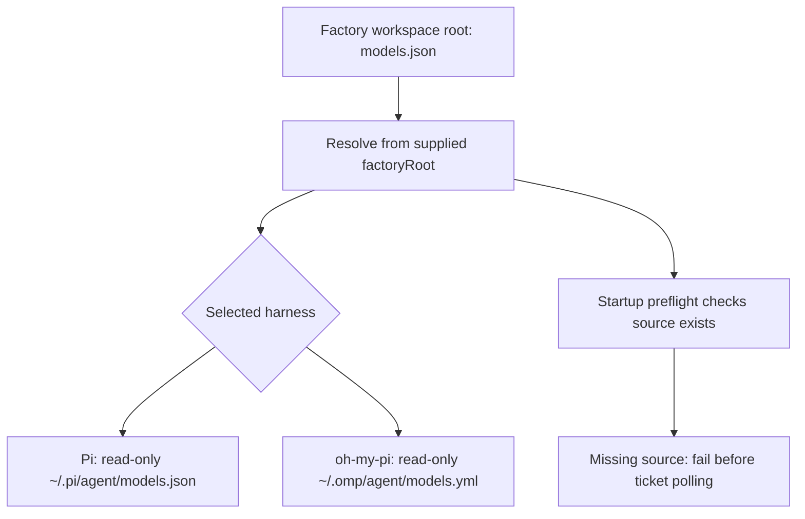

# Move the agent model catalog to workspace-root configuration

## 1. Human-review summary

### Summary
- Outcome: workspace-root `models.json` becomes the single model catalog used by both supported agent harnesses.
- Scope: move the existing catalog without changing its contents; update sandbox source resolution, behavioral coverage, and operational documentation. Keep attempts and parallelism explicit in the run command.
- Readiness: Execution-ready under the assumptions below.

### Explain like I'm five
The model settings are currently stored inside the runtime implementation. Move them to the factory workspace root so operators can configure models alongside the other workspace settings. The sandbox still supplies the same file read-only at each harness's expected location. Starting the runner still uses CLI options for concurrency and complete ticket attempts; those options do not become model settings.

### Target flow


### Affected code
```text
.                                          — models.json; README.md and AGENTS.md
├── docs/
│   └── plans/                             — this implementation plan only
└── factory/
    └── infrastructure/
        ├── agent-runtime/                 — remove old catalog and models-path.ts
        └── sandbox/                       — source resolution and sandbox regression coverage
```

### Assumptions
- “Root workspace” means the factory checkout root already represented by `factoryRoot`, not a ticket repository, process working directory, or container workspace.
- “JSON/JS” permits choosing JSON. Select `models.json` at the root rather than executable JavaScript or a broader application configuration file.
- Preserve the current provider/model data exactly. This is a configuration-location change, not a change to model selection or provider behavior.
- Use the existing documented example values: parallelism `2`, complete ticket attempts per cycle `3`. They are examples, not new defaults.

## 2. Scope and acceptance criteria

**In scope**
- Relocate `factory/infrastructure/agent-runtime/models.json` to root `models.json`.
- Resolve its sandbox host path from `factoryRoot` in the existing sandbox mount construction.
- Remove the obsolete `models-path.ts` indirection and its import.
- Preserve both harness destinations and read-only mounting.
- Update affected documentation and behavior-oriented sandbox coverage.
- Include both execution-limit flags explicitly in the documented run command.

**Out of scope**
- JavaScript configuration execution, conversion, generated configuration, environment interpolation, new schemas, override flags, hot reload, and fallback locations.
- Changing model IDs, endpoints, provider credentials, CLI defaults, retry semantics, or scheduling.
- Moving skills, MCP assets, Docker assets, samples, or historical plans.

**Acceptance criteria**
- AC1: root `models.json` has the same JSON data as the existing catalog; the old catalog and `models-path.ts` no longer exist and no active code depends on them.
- AC2: both harnesses receive the catalog from `resolve(factoryRoot, "models.json")`, read-only, at their existing native destinations, even when the process or ticket workspace is elsewhere.
- AC3: startup preflight rejects a missing root catalog with a diagnostic identifying the missing root path; it does not fall back to the former location. Help remains usable without configuration, Docker, or credentials.
- AC4: README.md and AGENTS.md accurately describe root ownership and native mount destinations. The operational run example explicitly includes `--max-parallel 2 --ticket-attempts-per-cycle 3`.
- AC5: real preflight and a bounded sandbox read demonstrate model visibility for both harnesses without changing handoff, MCP, skill, network, or credential-overlay mounts.

## 3. Design decisions

- D1: Use root `models.json` with the existing provider catalog shape. Reason: both harnesses already consume this JSON payload directly, including oh-my-pi through its YAML destination; JavaScript would require unnecessary execution and serialization. Contract: no wrapper object, renamed provider, or changed model values.
- D2: Resolve the host path directly inside `sandboxMounts` using its existing `factoryRoot` argument. Reason: the sandbox already owns mount construction and resolves skills from that root. Contract: no current-working-directory lookup, no ticket-local lookup, no additional host/stage API parameter, and no runtime-to-root module import.
- D3: Delete `models-path.ts` rather than retaining a compatibility resolver. Reason: its only discovered consumer is sandbox.ts, and its purpose becomes obsolete. Contract: migrate that consumer directly; retain no old-path fallback or duplicate catalog.
- D4: Preserve read-only destinations `/home/agent/.pi/agent/models.json` and `/home/agent/.omp/agent/models.yml`. Reason: this is a host configuration relocation, not a harness interface change. Contract: retain existing preflight path checking and harness-side format handling; add no separate configuration loader or validation layer.
- D5: Keep execution controls on the command line. Reason: attempts and parallelism are already runner CLI policy, not model catalog fields. Contract: document `npm run factory -- --max-parallel 2 --ticket-attempts-per-cycle 3`; for oh-my-pi append `--agent-harness oh-my-pi`. Existing defaults remain parallelism `1` and attempts `3`.

## 4. Implementation steps

### Step 1: Relocate the catalog and switch sandbox resolution
- **Code area:** root `models.json`, `factory/infrastructure/agent-runtime/`, and `factory/infrastructure/sandbox/sandbox.ts`.
- **Change:** Apply D1–D4 as one cutover. Move the catalog unchanged, replace the imported host path with `resolve(factoryRoot, "models.json")` in mount construction, remove the obsolete import and resolver file. Preserve all other mounts, native filenames, host networking, and existing preflight behavior. Before deleting the exported resolver, use available TypeScript language-server references to confirm its consumers; migrate any newly discovered active consumers directly.
- **Depends on:** None.
- **Verification:** Compare parsed catalog data before and after relocation (AC1). Inspect references for remaining active old-path consumers, excluding historical plans. Run the focused sandbox tests after Step 2 (AC2–AC3).

### Step 2: Cover mount behavior and missing-source failure
- **Code area:** `factory/infrastructure/sandbox/sandbox.test.ts`.
- **Change:** Replace the current bare `doesNotThrow` provider-construction test with behavior-oriented coverage. Exercise both harnesses using real temporary mount sources and a controlled Docker/process boundary. Observe the effective mount source, destination, and read-only behavior rather than private source text. Cover a supplied factory root distinct from the process/ticket workspace, and a missing root catalog without fallback. Use existing dependency seams where practical; do not export the private mount builder merely for assertions or introduce a general sandbox abstraction.
- **Depends on:** Step 1.
- **Verification:** Run `npx tsx --test factory/infrastructure/sandbox/sandbox.test.ts`. Confirm assertions catch an incorrect root, wrong harness destination, writable catalog, and missing-source acceptance (AC2–AC3). If readonly enforcement cannot be exercised through the controlled boundary, prove it in the real sandbox scenario in Section 5 rather than treating construction as evidence.

### Step 3: Align operational documentation and run examples
- **Code area:** `README.md` and root `AGENTS.md`.
- **Change:** Update README model-configuration and architecture descriptions to identify root `models.json` and remove the runtime catalog/resolver ownership claim. Update AGENTS runtime ownership and asset verification guidance so infrastructure consumes the root catalog rather than owns it. Preserve unaffected instructions and historical plans. Keep both execution controls explicit in the primary run example; do not shorten the example to rely on the default attempts value.
- **Depends on:** Steps 1–2.
- **Verification:** Review active documentation against implemented source and destinations. Confirm the documented command is `npm run factory -- --max-parallel 2 --ticket-attempts-per-cycle 3`, and the oh-my-pi variant adds only its harness selector. Verify both help commands in Section 5 (AC3–AC4).

## 5. End-to-end verification

The following are planned checks, not results already observed.

- Run `npm run verify`, `npm run factory -- --help`, and `npm run tickets -- --help`. Expect passing typecheck, tests, architecture checks, and help-first CLI behavior (AC1–AC3).
- Run real `preflightSandbox` for `pi` and `oh-my-pi` using the factory root and the built `local-sandcastle-runner:latest` image. Expect every mount source to exist and Docker image inspection to succeed. This host preflight alone does not prove in-container readability (AC5).
- Use a disposable bounded smoke driver through the existing sandbox provider for both harnesses, with real temporary handoff paths and a ticket workspace outside the factory checkout. Read the native model path inside each sandbox and compare parsed JSON to the root catalog; attempt a write and require rejection. Confirm existing MCP/handoff/model/skill resolution and factory `.env` masking remain correct, including the existing MCP preflight path. Do not invoke backlog/provider writes. Remove the disposable driver and temporary resources, preserving retained runner state (AC2, AC5).
- Cover the missing-catalog case with a temporary factory-root fixture, not by renaming the operator's actual catalog. Expect a missing root-path error before Docker inspection/ticket polling, even if a legacy-location file exists in the fixture (AC3).
- Operational command examples, after normal credentials, image, and private-backlog prerequisites are configured:

  ```bash
  npm run factory -- --max-parallel 2 --ticket-attempts-per-cycle 3
  npm run factory -- --agent-harness oh-my-pi --max-parallel 2 --ticket-attempts-per-cycle 3
  ```

  These commands run the daemon and may cause authorized backlog/target writes; do not use them as an unbounded smoke check. The bounded sandbox scenarios above verify the relocation without those remote effects (AC4).

## 6. Risks and open decisions

- **Risks:** root configuration may be confused with ticket-local or current-directory configuration; use the existing explicit `factoryRoot` and verify a distinct ticket workspace. Root settings are visible to factory-checkout agents just as other checkout files are; preserve existing planner immutability enforcement. Do not add production secrets while relocating the catalog or print its contents in diagnostic logs.
- **Risks:** Docker/image availability can prevent real sandbox proof. Record the exact unavailable prerequisite separately from passing controlled checks; do not describe provider construction or mocked execution as real preflight evidence. Both harnesses must retain their native destination filenames despite sharing one JSON source.
- **Open decisions:** None under the stated assumptions. JSON is the selected format; execution controls remain CLI options.
