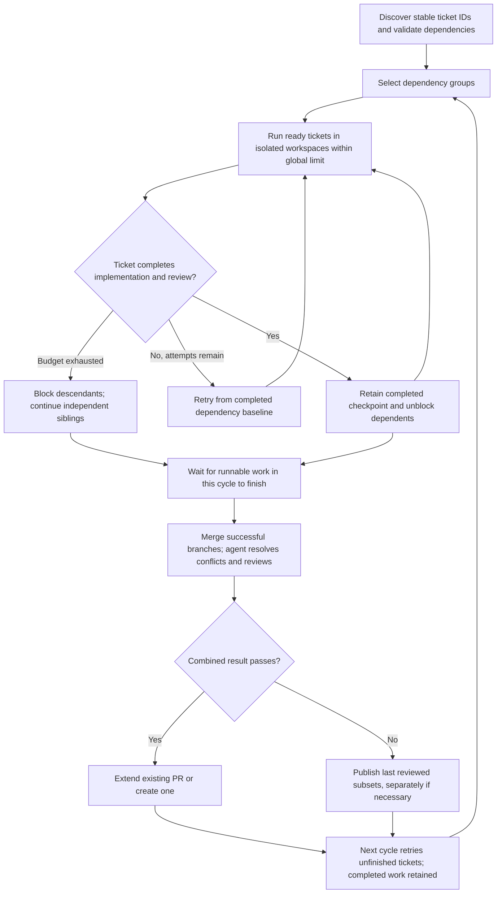

# Ticket dependencies and reviewed group pull requests

## 1. Human-review summary

### Summary
- Outcome: Tickets declare stable identities and dependencies, build on completed dependency branches before upstream merge, and normally deliver one reviewed pull request per connected dependency group.
- Scope: Dependency discovery, bounded parallel ticket execution in isolated workspaces, fresh retries, agent-assisted integration and combined review, reviewed-subset fallback, and existing-PR extension for both GitHub and Azure DevOps. No production changes are made by this document.
- Readiness: **Blocked by** restart/recovery policy, handling ticket edits after checkpoints exist, and safe handling of externally changed or merged PRs. Attempt/concurrency defaults below are proposed, not user-approved. Reconcile the in-progress stage-checkpoint cutover before implementing integration commits.

### Explain like I'm five
A completed ticket leaves a reviewed Git checkpoint that dependent tickets can start from without waiting for a human to merge its PR. Independent siblings work in separate workspaces and may run at the same time. The factory combines successful branches and has an agent resolve conflicts and review their combined behavior. If part of the group cannot finish, it publishes the reviewed work that can safely ship, keeps downstream tickets blocked, and tries the unsuccessful work again next cycle. Later success extends the existing PR when possible; separate PRs are permitted when reviewed subsets cannot safely be combined.

### Target flow


### Affected code
```text
.
├── README.md                                  — implemented metadata, concurrency, retries, and PR lifecycle
├── AGENTS.md                                  — implemented ownership and changed workflow contracts
├── .dependency-cruiser.cjs                     — allow the integration stage without weakening boundaries
├── docs/
│   └── plans/                                 — this proposed plan only
└── factory/
    ├── main.ts                                — construct dependencies and pass execution configuration
    ├── cli/                                   — proposed global concurrency and attempt-budget options; tests
    ├── features/
    │   ├── tickets/                           — stable IDs, dependency metadata, annotations, lifecycle tests
    │   ├── plan-tickets/                      — group selections, prompt/schema, immutable planning tests
    │   ├── ticket-processing/                 — graph scheduler, state, fresh baselines, settlement, tests
    │   ├── implement-ticket/                  — dependency context and isolated attempt contract; tests
    │   ├── review-ticket/                     — preserve ticket review and checkpoint contract; tests
    │   ├── integrate-tickets/                 — NEW: conflict-resolution/combined-review prompt and contract; tests
    │   └── publish-pull-request/              — subset content, safe PR extension/fallback, publication tests
    └── infrastructure/
        ├── git-provider/                      — Git integration operations and provider PR lookup/update; tests
        └── logging/                           — correlated concurrent records and unique log paths; tests
```

### Assumptions
- “A stable idea declaring that each take us from the matter” means a stable ID explicitly declared in each ticket's front matter.
- A delivery group is a connected component of the dependency graph, including independent siblings sharing an ancestor. Membership does not mean every member must succeed before any reviewed work can ship.
- “When the last one is completed” means when all currently runnable branches have completed or exhausted this cycle's budget. A blocked descendant must not make that barrier wait forever.
- Parallelism is permission, not a requirement to run every ticket concurrently. A default limit of one preserves conservative resource use while allowing an explicitly larger limit.
- Dependency groups share one canonical repository and base branch. Cross-repository dependency delivery is excluded from this proposal.
- Attempts exhausted in one cycle do not impose a lifetime terminal limit: the user explicitly requested automatic retry next cycle. Partial recovery of failed attempts remains out of scope.

## 2. Scope and acceptance criteria

**In scope**
- Explicit front-matter `id` and `dependsOnTickets`; stable logical identity separate from source-change detection.
- Dependency graph validation and connected delivery groups; multiple-parent readiness and sibling isolation.
- Globally bounded parallelism, complete-attempt retry budgets, retained reviewed checkpoints, and nonterminal blocked/retryable states.
- Dedicated integration workspaces, conflict resolution by an agent, combined review, and conflict documentation in PR text.
- One group PR where feasible; extending a known open PR; new-PR fallback; multiple reviewed-subset PRs when integration fails.
- Provider-neutral lookup/update APIs with GitHub and Azure DevOps implementations and preserved security/provider behavior.
- Updated contract tests, real temporary Git integration coverage, and implemented-behavior documentation during implementation.

**Out of scope**
- Continuing partial work from failed attempts; resetting or deleting retained failed workspaces.
- Cross-repository groups, automatic upstream merge, auto-merge enablement, repository policy changes, or branch deletion.
- A generic workflow engine, event bus, stage registry, distributed scheduling, multiple cooperating factory processes, or unrelated cancellation changes.
- Automatic rewriting of user-authored ticket IDs, unrelated historical sample/skill changes, or changes to old plans.
- Live provider writes without an authorized disposable repository.
- Restart persistence is not silently included or excluded: it requires the decision in section 6 before implementation is execution-ready.

**Acceptance criteria**
- AC1: Editing a ticket's body or appending an annotation does not change its declared identity or break dependency references. `dependsOnTickets: [ticket-abc, ticket-dfg]` resolves those declared IDs.
- AC2: Duplicate IDs, duplicate/self dependencies, cycles, and incompatible repository/base-branch edges produce actionable diagnostics without starting invalid graph work. A missing dependency keeps the affected ticket blocked and can resolve when that ticket arrives.
- AC3: For A → B, B starts from A's clean, completed reviewed checkpoint before A is merged upstream; successful A and B are delivered together in one PR.
- AC4: Each complete retry of B uses a fresh retained workspace at the same completed dependency baseline, excluding failed B commits and dirty files. A is not rerun.
- AC5: After B exhausts this cycle's budget in A → B → C, A can publish, B remains retryable, and C is blocked without being attempted. Next cycle automatically retries B; when B succeeds, C becomes eligible without user action.
- AC6: For siblings B and C depending only on A, each starts with A but without the other's ticket-specific changes. They can execute concurrently without exceeding the global limit. B failure still allows A + C to publish.
- AC7: D depending on both B and C starts only from their successfully merged, reviewed result. Individual parent success alone is insufficient.
- AC8: Successful siblings are integrated after runnable work settles; an agent resolves merge conflicts and reviews the combined result. Published trees contain no unresolved merge entries, dirty files, or committed conflict markers introduced by resolution. PR text records every encountered conflict and its disposition.
- AC9: Failed combined review cannot publish that unreviewed combination. The factory publishes the last successful reviewed subset, or separate reviewed-subset PRs when needed, without discarding successful ticket branches.
- AC10: Later successful work extends an identifiable, safely writable open PR when possible. If it cannot be identified or updated, the factory creates a new draft PR from retained reviewed work rather than abandoning it. Unsafe update failure does not overwrite someone else's branch.
- AC11: PR content distinguishes included, retryable, blocked, and integration-excluded tickets and conflict resolutions. Terminal completion annotations apply only to tickets actually included in a successful publication; successful unpublished checkpoints remain reusable.
- AC12: Publication retains read-only content generation, commit-count and net-change gates, final-SHA reporting, SSH push, draft status, squash preference reporting, credential isolation/redaction, and structured substage failures. Post-publication annotation/movement failure does not republish.
- AC13: Invalid global limits fail before agent/sandbox work, `--help` still exits before environment/credential/preflight work, logs remain attributable under concurrency, and idle polling remains ten seconds without adding retry backoff.

## 3. Design decisions

- D1: **Use front-matter `id` as logical identity; retain a separate full-source hash.** Reason: Dependencies cannot target an identity that changes with append-only annotations. Contract: Proposed metadata is `id: ticket-abc`, existing `name`, `repository`, optional `baseBranch`, and optional `dependsOnTickets` defaulting to `[]`. Require trimmed nonempty, case-sensitive IDs without whitespace/control characters. Require explicit IDs for runtime tickets; do not infer IDs from filenames or silently alias old hashes. Retain the current SHA-256 full-source computation as proposed `sourceHash`, not a dependency key. Preserve slug/title derivation and provider URL validation. Migrate affected callers and controlled fixtures directly. Source hash alone does not decide whether annotation-only changes invalidate completed work; resolve ticket-edit policy first.
- D2: **Workflow owns the graph and component identity; planner chooses validated delivery groups.** Reason: An agent can prioritize work but must not decide dependency truth or readiness. Contract: `tickets` owns metadata and narrow dependency-reference records; coordinator-private graph helpers own edges, connected components, topological eligibility, and component state. Proposed planner selections use stable group ID plus validated member IDs/titles, not a free-form merge plan. A component ID is assigned by the coordinator and retained for its lifetime rather than recalculated from mutable annotations. Component membership is rebuilt at cycle boundaries; no live mutation of a running batch. Preserve factory HEAD/porcelain immutability, configured harness, completion tags, and fatal planner-contract violations. Unknown references are blocked pending arrival; duplicates/cycles and incompatible edges are invalid metadata/graph diagnostics, not retried agent failures.
- D3: **Separate branches/workspaces and immutable dependency baselines.** Reason: This supports sibling parallelism and fresh retries without shared mutable Git state. Contract: Reserve fresh retained directories using existing collision safeguards. Each attempt clones the canonical repository, imports required local retained Git objects through explicit Git operations, and checks out its own branch at a validated dependency SHA. Keep `origin` pointing at the ticket repository and preserve clone/branch postconditions. A single dependency uses its reviewed checkpoint. Multiple dependencies use a dedicated reviewed integration checkpoint. Pin the baseline for the attempt; never inherit an unrelated sibling's changes. Verify SHA availability, provenance, and cleanliness before starting the agent. Preserve failed workspaces without adopting their partial work.
- D4: **Use a coordinator-owned bounded ready queue, not a pipeline framework.** Reason: Parallel execution is required only where dependencies permit it. Contract: Proposed `--max-parallel <positive integer>` defaults to `1`, parsed in `cli`, passed through `main` to `ProcessConfig`; remove planner-owned `MAX_PARALLEL` as an execution policy. The limit applies globally across groups to active ticket or integration/review agent jobs, not separately to every group. Use one lease per job, release it in `finally`, and do not hold a lease while waiting for another job's lease. Planning stays serialized at the cycle boundary and publication is serialized per group/PR. Every asynchronous job is awaited; one ticket failure does not cancel independent work. Execution may refill freed capacity with newly ready descendants. Serialize coordinator state transitions and ticket-file writes per identity; generic logging stays ticket-policy-free.
- D5: **Separate complete attempts from stage iterations.** Reason: Existing three implementation/review iterations continue partial work inside one workspace; the requested fresh retry is a different boundary. Contract: Proposed `--ticket-attempts-per-cycle <positive integer>` defaults to `3`. Each complete attempt includes fresh workspace creation, implementation, review, and required checkpoint postconditions. Preserve each existing stage's three-iteration limit and completion enforcement; do not reset an internal stage iteration midway and call it a new complete attempt. Once the complete-attempt budget is exhausted, do not run that ticket again until the next cycle. Next cycle resets that budget automatically with no lifetime cap. Preserve successful ancestor checkpoints and retry only unsuccessful work. These numeric defaults are proposals requiring review.
- D6: **Represent ticket progress and delivery separately.** Reason: An implemented ticket can remain reusable while blocked descendants or publication are unresolved. Contract: Proposed private states distinguish pending/ready, running, retryable, blocked with blocker IDs/reason, and implemented with a reviewed checkpoint. Publication records separately map included IDs to final SHA and PR identity. An attempt failure is not a terminal ticket failure and does not enter planner terminal-ID suppression. Blocked tickets are not moved to a terminal `failed/` directory. Keep retryable/blocked source tickets discoverable, append state transitions without duplicating unchanged blocked annotations each cycle, and move published tickets to `done/` through guarded settlement. Retain their dependency checkpoints in workflow state so dependents can proceed after source movement. Invalid metadata still follows existing guarded diagnostic handling. Replacing boolean `TicketOutcome.completed` requires direct migration of every consumer to explicit workflow/delivery outcomes, not a compatibility alias. Restart reconstruction remains a blocking decision.
- D7: **Introduce a narrow `integrate-tickets` stage; coordinator sequences Git operations and calls it.** Reason: Resolving conflicts and reviewing combinations is distinct from reviewing one ticket, and stages must not import each other. Contract: New feature exposes only its public `index.ts`, stage-owned input/output, prompt, and tests. Inputs contain ticket summaries, dependency/candidate SHAs, included IDs, conflict paths, workspace/branch, and explicit integration task—not coordinator attempt objects. Coordinator starts deterministic Git merges in a fresh integration workspace; the integration agent resolves conflicts and reviews the combined behavior using the configured runtime. Preserve completion enforcement and a bounded repair budget (proposed three stage iterations). Do not reuse a single-parent checkpoint helper for multi-parent merges: add narrowly owned Git merge/finalization primitives and enforce expected parents, clean index/worktree, and no unmerged entries. Match the settled stage-commit ownership model; do not let both agent and runner own the same commit. Perform combined review even when Git reports no textual conflict. Document conflict paths and resolution decisions in PR text, including resolved conflicts encountered while preparing multiple-parent baselines; a resolution commit may additionally carry that evidence, never unresolved markers.
- D8: **Retain reviewed subsets and isolate integration failure.** Reason: User explicitly permits separate PRs rather than losing independently successful work. Contract: Record immutable reviewed candidate checkpoints with included ticket IDs and dependency closure. Merge candidates in deterministic stable-ID order without mutating source branches. On unsuccessful integration/combined review, retain the last reviewed checkpoint and the separate reviewed candidates. Publish dependency-closed reviewed subsets; do not label a ticket included merely because its individual branch passed. Shared ancestors may occur in separate fallback PRs and must be identified in their descriptions. If B and C cannot form a reviewed baseline together, D depending on both remains blocked even if B and C have separate PRs. Failed integration candidates must never become a ticket baseline or PR head.
- D9: **Extend a tracked open PR safely; create a draft fallback otherwise.** Reason: Automatic continuation should retain a single delivery surface when feasible without sacrificing work. Contract: Add provider-neutral lookup and update operations in `git-provider`, implemented by both adapters. The coordinator owns group/subset publication identities; `publish-pull-request` owns read-only content and publication steps. Record repository, base/head refs, PR number/URL, included IDs, and last published SHA. Lookup requires a known identity or unambiguous factory marker plus matching canonical repository/base/head; never pick a PR by title alone. Extend an existing source branch only with a reviewed descendant of its last published SHA and after checking remote identity. Use non-force pushes; do not rewrite a tracked PR's history to remove failed work. If update is unavailable, rejected, or ambiguous, publish a fresh uniquely named branch and PR with links to known prior publications. Record lookup/update/fallback diagnostics distinctly. An indeterminate HTTP response may have applied the operation: re-read provider state before creating a duplicate. Exact policy for human changes, merged/closed PRs, and base refresh is a blocking decision in section 6.
- D10: **Keep ownership boundaries and existing publication safety.** Reason: The requested change expands workflow behavior, not infrastructure awareness. Contract: `ticket-processing` owns scheduling, retries, checkpoint/subset state, and settlement; `tickets` owns file identity/lifecycle; stages own their prompts/schemas; Git/provider mechanisms stay in `infrastructure/git-provider`; `main` only constructs dependencies/configuration. No stage-to-stage/coordinator imports, including type-only imports. Extend architecture allowlists narrowly for the new feature. Preserve Azure API version `7.1`, encoded path segments, qualified refs, browser-facing URLs, draft/squash behavior, provider selection, credential redaction, host credential masking, and SSH-only clone/push. Publication reports facts and PR data, never terminal ticket outcomes. Preserve existing substages including the observed `change set` gate and unwrap causes before diagnostic translation. Preserve no-republish settlement behavior with multiple published subsets.

## 4. Implementation steps

### Step 1: Resolve lifecycle policies and align the checkpoint prerequisite
- **Code area:** `docs/plans/`; inspect the current `factory/features/ticket-processing/`, `factory/features/implement-ticket/`, and `factory/features/review-ticket/` contracts without changing them in this prerequisite.
- **Change:** Resolve section 6's blocking policies and record exact contracts in this plan before runtime implementation. Confirm D4/D5 defaults. Reconcile the existing stage-checkpoint work with `docs/plans/stage-commits-and-squash-merge-implementation-plan.md` and operational instructions. At inspection, `stage-commit.ts` and structured stage schemas exist, while the inspected `execute-attempt.ts` still invokes stages without consuming their results/checkpointing. Treat that as in-progress work, not a stable commit model or permission to redo it. Select one settled integration commit-ownership contract compatible with that cutover.
- **Depends on:** None.
- **Verification:** Every blocker has a concrete state transition, storage/safety contract, and verification scenario. No major restart/edit/remote-change decision is left to an implementer; readiness can then become execution-ready. This is planning verification, not a claim of runtime proof.

### Step 2: Add stable ticket identity and dependency metadata
- **Code area:** `factory/features/tickets/`; affected fixtures/callers in the feature folders shown in the tree.
- **Change:** Implement D1 and metadata portions of D2/D6. Add explicit IDs and validated dependency arrays, retain the source hash separately, and expose narrow metadata/lifecycle APIs through `index.ts`. Migrate all affected ticket fixtures and runtime callers to stable IDs; retain sorted root-level discovery and append-only annotations. Add distinct blocked/retryable annotations and included-publication metadata without moving those states to terminal failure directories. Apply the resolved edit policy rather than interpreting annotation edits as new tickets.
- **Depends on:** Step 1.
- **Verification:** Colocated `node:test` coverage uses real Markdown files to prove stable references through body edits and annotations, rejected malformed/duplicate/self references, and correct retryable/blocked movement behavior (AC1, AC2, AC11).

### Step 3: Build workflow graph state and group planning
- **Code area:** `factory/features/ticket-processing/`, `factory/features/plan-tickets/`.
- **Change:** Implement coordinator-private graph validation, connected components, retained group identity, readiness, and separate checkpoint/delivery states (D2/D6). Supply stage-owned group selection records and context to the planner. Replace single-ticket selection/schema limits with validated group prioritization; do not let model output bypass graph closure/readiness or global capacity. Remove exhausted attempts from terminal-ID suppression; retain true published state/checkpoints for dependency resolution after `done/` movement. Implement the resolved state reconstruction policy if restart recovery is selected.
- **Depends on:** Step 2.
- **Verification:** Graph scenarios cover chain, diamond, siblings, missing dependency arrival, invalid cycles/duplicate IDs, same-repository/base validation, and published-ancestor lookup (AC2, AC5, AC7, AC11). Planner tests reject unknown/duplicate/mutated selections and missing completion while retaining the real factory immutability check.

### Step 4: Configure and schedule bounded parallel work
- **Code area:** `factory/cli/`, `factory/main.ts`, `factory/features/ticket-processing/`, `factory/infrastructure/logging/`.
- **Change:** Implement reviewed D4/D5 configuration, ready-queue scheduling, and explicit cycle exhaustion. Separate planner selections from runtime capacity; await all runnable work before group publication. Give ticket/integration stages unique group/ticket/attempt/stage log names. Serialize conflicting state/file writes without holding execution slots through nested waiting. Maintain the idle sleep contract and automatic next-cycle retries without introducing backoff or new cancellation policy.
- **Depends on:** Step 3.
- **Verification:** Barrier-controlled agents prove independent siblings overlap with limit two, no job count exceeds the configured global bound across multiple groups, and limit one serializes actual agent jobs. Failure does not cancel a sibling; exhaustion defers only that ticket until next cycle. Exercise CLI help and invalid numeric options before credentials/preflight (AC5, AC6, AC13). Log assertions check attributed outcomes and credential redaction, not incidental wording.

### Step 5: Create fresh dependency-based attempts
- **Code area:** `factory/features/ticket-processing/`, `factory/features/implement-ticket/`, `factory/features/review-ticket/`, `factory/infrastructure/git-provider/`.
- **Change:** Implement D3/D5 attempt baselines and checkpoint outputs. Root tickets start from the validated base; single-parent tickets import and start from the completed dependency checkpoint; multi-parent tickets wait for Step 6's reviewed baseline. Include dependency summaries/SHAs in implementation input without leaking coordinator state. Return completed reviewed checkpoints instead of publishing immediately inside every ticket attempt. Fresh complete retries reserve new workspaces and import only the pinned dependency baseline; retain failed files/commits in their original directories. Preserve the settled implementation/review stage contract and existing diagnostic causes.
- **Depends on:** Steps 1, 4; multi-parent execution requires Step 6.
- **Verification:** Real temporary repositories prove B sees A's unmerged committed content, siblings do not see each other's changes, the second B attempt lacks a failed-attempt commit and untracked sentinel, and A is not rerun (AC3, AC4, AC6). Validate origin/branch/SHA/cleanliness postconditions and retained workspaces on setup failure.

### Step 6: Integrate and review dependency baselines and delivery subsets
- **Code area:** `factory/features/integrate-tickets/` (new), `factory/features/ticket-processing/`, `factory/infrastructure/git-provider/`, `.dependency-cruiser.cjs`.
- **Change:** Implement D7/D8 through an isolated integration stage and Git mechanisms. Build deterministic reviewed candidates for multiple-parent prerequisites and final group delivery. Let the agent resolve conflicts and verify combined behavior, then finalize commits according to the settled ownership model and enforce clean expected history. Preserve reviewed candidates on failed integration; record encountered conflicts and dispositions. Produce explicit dependency-closed reviewed subsets for fallback and keep multi-parent dependents blocked when no reviewed combined prerequisite exists. Adjust architecture rules only to recognize the new stage under the existing public-entry constraints.
- **Depends on:** Steps 1, 3, 5.
- **Verification:** Real Git repositories generate sibling text conflicts and nonconflicting semantic incompatibilities. Controlled agent output resolves the former; combined review rejects the latter. D starts only after a reviewed B+C baseline; unsuccessful combined review leaves source checkpoints intact and yields publishable subsets without adopting the failed integration tree (AC7, AC8, AC9). Demonstrate architecture rejection of temporary stage-to-stage and type-only deep imports, then remove those fixtures.

### Step 7: Add provider PR discovery and updates
- **Code area:** `factory/infrastructure/git-provider/`.
- **Change:** Implement D9's narrow provider-neutral read/update contracts and both adapters, including unambiguous identity lookup, PR state/head/base identity, title/body updates, and browser-facing results. Preserve existing request/authentication conventions and structured command diagnostics. Report missing/closed/ambiguous/unsupported update conditions explicitly so publication can safely select fallback. Verify uncertain update/create results through readback rather than blindly creating duplicates. Do not add provider merge/auto-completion behavior.
- **Depends on:** Step 1's remote-change policy and Step 3's publication identity contract.
- **Verification:** Existing HTTP seams validate GitHub and Azure lookup/update requests, Azure `7.1`/encoded segments/qualified refs, draft and squash behavior, ambiguous matches, rejected updates, uncertain write readback, and raw/derived credential redaction (AC10, AC12).

### Step 8: Publish reviewed groups/subsets and settle only included tickets
- **Code area:** `factory/features/publish-pull-request/`, `factory/features/ticket-processing/`, `factory/features/tickets/`.
- **Change:** Replace singular-ticket publication input with a small stage-owned reviewed-delivery input containing included ticket summaries, canonical repository/base, reviewed head, conflict evidence, and optional existing publication identity. Implement D8–D10: immutable PR content, honest included/blocked/excluded lists, safe non-force extension, fresh draft fallback, and separate subset publications. Update every caller directly. Persist/retain publication facts according to Step 1 before guarded completion annotations/movement. Do not republish already recorded subsets on settlement error or repeat unchanged publications every retry cycle; retain completed checkpoint dependencies after settlement.
- **Depends on:** Steps 3, 6, 7.
- **Verification:** Real bare remote plus provider seams prove final pushed SHA corresponds to the reviewed subset, A+C ships after B failure, later B/C continuation extends a known PR, update failure creates a new draft, and incompatible reviewed subsets produce separate PRs (AC3, AC5, AC9, AC10). Verify conflict evidence and included-only settlement, zero-net-change rejection, structured substages, and no duplicate publication after annotation/movement failure (AC8, AC11, AC12).

### Step 9: Verify the complete workflow and document implemented behavior
- **Code area:** `factory/features/ticket-processing/` and affected colocated tests; `README.md`, `AGENTS.md`.
- **Change:** Exercise section 5 through bounded real-Git runs with controlled agents and provider HTTP seams. Update operational documentation only after behavior exists and is verified: ticket metadata, concurrency/budget configuration, blocked/retryable states, subset exceptions, retained checkpoints, PR extension, and the selected restart/edit/remote-change policies. Replace superseded sequential/single-ticket/terminal-failure instructions without rewriting unrelated content or historical plans. Remove disposable drivers and illegal-import fixtures; preserve user workspaces/logs/ticket files.
- **Depends on:** Steps 2–8.
- **Verification:** Every acceptance criterion has observed evidence, repository checks succeed, and documentation matches implemented—not proposed—behavior. Report controlled integration separately from live Docker/model/provider prerequisites.

## 5. End-to-end verification

These are **planned checks**, not observed results from this planning change.

- **Happy-path diamond:** Create real temporary tickets/repository/bare remote for A, siblings B/C, and D depending on both. With limit two, observe overlapping B/C execution, isolated parents, reviewed sibling integration, D's merged baseline, one reviewed final PR request, exact pushed SHA, unique logs, and completion files (AC1, AC3, AC6, AC7, AC8, AC11–AC13).
- **Failure followed by continuation:** Use A → B → C, exhaust B's complete-attempt budget, and observe A-only publication, B retryable, C blocked, retained A baseline, and no terminal suppression of B. Invoke the next bounded cycle with successful B/C; confirm no rerun of A, fresh B attempt without failed partial content, automatic C unblocking, and extension of the original PR (AC4, AC5, AC10, AC11).
- **Independent sibling progress:** Fail B while successful C shares A. Observe A+C publication after runnable branches settle, only B's descendants blocked, and preserved B/C checkpoints for later continuation (AC5, AC6, AC9).
- **Integration and fallback:** Force a real merge conflict, resolve it through the controlled integration agent, review the combination, and inspect conflict evidence in PR content. Separately exhaust combined-review repairs while individual branches remain reviewed: observe the last reviewed subset and separate fallback PRs, with no failed integration tree published and multi-parent D still blocked (AC7–AC9).
- **PR safety/provider boundaries:** Run lookup/update/fallback scenarios for both provider adapters: ambiguous/missing identity, denied update, externally changed head, closed/merged PR under the chosen policy, and a write applied despite an uncertain response. Observe preserved reviewed work, non-force Git behavior, correct final SHA, and no duplicate publication from settlement failures (AC10–AC12).
- **Graph/configuration boundaries:** Exercise duplicate IDs, cycles, incompatible repository/base, missing dependency arrival, annotation-only rediscovery, selected body-edit policy, invalid limits, and total active jobs across multiple groups (AC1, AC2, AC13). If restart recovery is selected, restart between checkpoint, push, PR creation, and settlement and prove reconstruction without rerunning completed work or duplicating PRs.
- Run `npm run verify` from the repository root: strict typecheck, recursive factory tests, and architecture checks all succeed. Run `npm run sandcastle -- --help`: the actual CLI/import surface exits without `.env`, credentials, Docker, or agent execution. Do not narrow discovery or weaken the architecture checker to obtain a pass.
- Controlled workflow smoke uses actual ticket files, fresh Git workspaces and a bare remote, real logging, controlled stage outputs at the existing agent seam, and provider HTTP seams. Remove disposable drivers/fixtures afterward. Live sandbox/model/provider execution is a separate check requiring its real prerequisites and authorized disposable remote repository; do not present controlled results as live evidence.

## 6. Risks and open decisions

**Risks**
- Automatic next-cycle retry has no lifetime cap and can repeatedly spend model capacity on an irreparable ticket. Honor the requested behavior; surface retry counts/reasons through existing logs and annotations. Do not silently introduce backoff, pause states, or lifetime limits.
- Independently reviewed branches can be semantically incompatible without textual conflicts. Combined review is required even for clean Git merges; only reviewed dependency-closed candidates are publishable.
- Separate fallback PRs can duplicate shared ancestor changes. Identify their common ancestry and relationship explicitly; merged-base handling needs the remote lifecycle decision below before correctness can be claimed.
- Concurrent processes or external humans can change branches/PRs. This proposal supports one factory invocation and rejects unsafe branch extension; no force push or guessed PR association.
- File annotation/movement and remote publication are not one transaction. Keep publication facts separate from settlement, verify uncertain remote results, and never retry publication merely because settlement failed.
- Current inspected code contains in-progress stage-commit work while operational instructions still describe agent-owned commits. Preserve that work and reconcile its completed contract before adding integration finalization; a merge commit cannot satisfy `commitStage`'s existing single-parent invariant.

**Open decisions**
- **Restart recovery:** Should automatic continuation survive process restarts? Existing workflow state is in memory. Durable recovery requires a selected storage location/schema, atomic checkpoint/publication writes, reference validation, and restart tests; invocation-only behavior cannot honestly promise restart continuation. This blocks final state/storage design.
- **Ticket edits after success:** Should changing requirements under the same stable ID invalidate that ticket and descendants, or be rejected until the user creates a new ID? Define which content contributes to the revision fingerprint so append-only factory annotations do not invalidate checkpoints. This blocks safe checkpoint reuse and rediscovery behavior.
- **Human/remote lifecycle:** Define continuation after an A-only PR is merged (including squash merge), closed, or externally modified. Select whether/how to rebase retained dependency work onto a refreshed base and how to prevent replaying already merged ancestor changes in a new PR. Define which externally changed PR heads are safe to extend versus new-PR fallback. This blocks remote reconciliation and safe publication beyond the unmodified open-PR case.
- **Proposed numeric defaults:** Review the new CLI names and defaults: global limit `1`, three complete attempts per ticket per cycle, and three integration repair iterations, distinct from the existing three implementation/review iterations. The conversation established bounded attempts and global capacity, not their numbers or configuration surface.
- **In-progress prerequisite:** Confirm the settled stage-checkpoint ownership and its completed caller migration before execution. This plan does not complete, replace, or edit that unrelated in-progress cutover.
