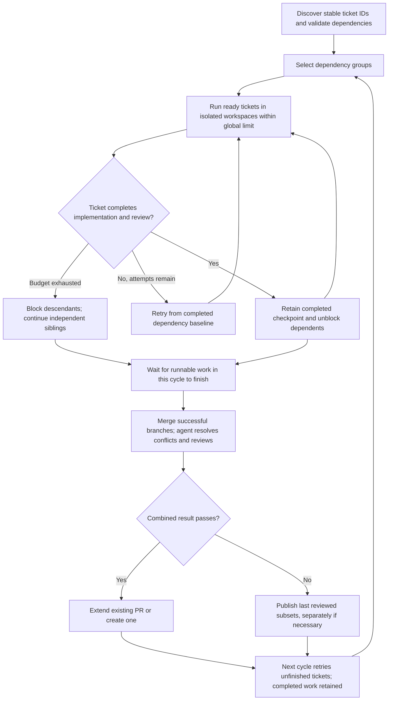

# Ticket dependencies and reviewed group pull requests

## 1. Human-review summary

### Summary
- Outcome: Tickets declare stable identities and dependencies, build on completed dependency branches before upstream merge, and normally deliver one reviewed pull request per connected dependency group.
- Scope: Dependency discovery, bounded parallel ticket execution in isolated workspaces, fresh retries, agent-assisted integration and combined review, reviewed-subset fallback, and existing-PR extension for both GitHub and Azure DevOps. No production changes are made by this document.
- Readiness: **Execution-ready for the selected scope.** Lifecycle policies and numeric defaults are approved: invocation-only continuation, a new ID for changed completed requirements, and verified remote reconciliation with safe draft fallback. The stage-checkpoint and squash-preference cutover is implemented in the current working tree (staged, not yet committed); preserve it as the baseline.

### Explain like I'm five
A completed ticket leaves a reviewed Git checkpoint that dependent tickets can start from without waiting for a human to merge its PR. Independent siblings work in separate workspaces and may run at the same time. The factory combines successful branches and has an agent resolve conflicts and review their combined behavior. If part of the group cannot finish, it publishes the reviewed work that can safely ship, keeps downstream tickets blocked, and tries the unsuccessful work again next cycle. Later success extends the existing PR when possible; separate PRs are permitted when reviewed subsets cannot safely be combined.

### Target flow


### Affected code
```text
.
├── README.md                                  — implemented metadata, concurrency, retries, and PR lifecycle
├── AGENTS.md                                  — implemented ownership and changed workflow contracts
├── .dependency-cruiser.cjs                     — allow the integration stage without weakening boundaries
├── docs/
│   └── plans/                                 — this proposed plan only
└── factory/
    ├── main.ts                                — construct dependencies and pass execution configuration
    ├── cli/                                   — proposed global concurrency and attempt-budget options; tests
    ├── features/
    │   ├── tickets/                           — stable IDs, dependency metadata, annotations, lifecycle tests
    │   ├── plan-tickets/                      — group selections, prompt/schema, immutable planning tests
    │   ├── ticket-processing/                 — graph scheduler, state, fresh baselines, settlement, tests
    │   ├── implement-ticket/                  — dependency context and isolated attempt contract; tests
    │   ├── review-ticket/                     — preserve ticket review and checkpoint contract; tests
    │   ├── integrate-tickets/                 — NEW: conflict-resolution/combined-review prompt and contract; tests
    │   └── publish-pull-request/              — subset content, safe PR extension/fallback, publication tests
    └── infrastructure/
        ├── git-provider/                      — Git integration operations and provider PR lookup/update; tests
        └── logging/                           — correlated concurrent records and unique log paths; tests
```

### Assumptions
- “A stable idea declaring that each take us from the matter” means a stable ID explicitly declared in each ticket's front matter.
- A delivery group is a connected component of the dependency graph, including independent siblings sharing an ancestor. Membership does not mean every member must succeed before any reviewed work can ship.
- “When the last one is completed” means when all currently runnable branches have completed or exhausted this cycle's budget. A blocked descendant must not make that barrier wait forever.
- Parallelism is permission, not a requirement to run every ticket concurrently. A default limit of one preserves conservative resource use while allowing an explicitly larger limit.
- Dependency groups share one canonical repository and base branch. Cross-repository dependency delivery is excluded from this proposal.
- Attempts exhausted in one cycle do not impose a lifetime terminal limit: the user explicitly requested automatic retry next cycle. Partial recovery of failed attempts remains out of scope.
- Automatic continuation is guaranteed only within one invocation. Retained artifacts are not an automatic restart-recovery database; prior work requires operator reconciliation before a new invocation may reuse or republish it.

## 2. Scope and acceptance criteria

**In scope**
- Explicit front-matter `id` and `dependsOnTickets`; stable logical identity separate from source-change detection.
- Dependency graph validation and connected delivery groups; multiple-parent readiness and sibling isolation.
- Globally bounded parallelism, complete-attempt retry budgets, retained reviewed checkpoints, and nonterminal blocked/retryable states.
- Dedicated integration workspaces, conflict resolution by an agent, combined review, and conflict documentation in PR text.
- One group PR where feasible; extending a known open PR; new-PR fallback; multiple reviewed-subset PRs when integration fails.
- Provider-neutral lookup/update APIs with GitHub and Azure DevOps implementations and preserved security/provider behavior.
- Updated contract tests, real temporary Git integration coverage, and implemented-behavior documentation during implementation.

**Out of scope**
- Continuing partial work from failed attempts; resetting or deleting retained failed workspaces.
- Cross-repository groups, automatic upstream merge, auto-merge enablement, repository policy changes, or branch deletion.
- A generic workflow engine, event bus, stage registry, distributed scheduling, multiple cooperating factory processes, or unrelated cancellation changes.
- Automatic rewriting of user-authored ticket IDs, unrelated historical sample/skill changes, or changes to old plans.
- Live provider writes without an authorized disposable repository.
- Durable state storage, automatic restart reconstruction, and automatic reuse/republication of work from prior invocations. Startup safety diagnostics are in scope; an operator reconciles prior work before resubmitting it.

**Acceptance criteria**
- AC1: Editing a ticket's body or appending an annotation does not change its declared identity or break dependency references. `dependsOnTickets: [ticket-abc, ticket-dfg]` resolves those declared IDs.
- AC2: Duplicate IDs, duplicate/self dependencies, cycles, and incompatible repository/base-branch edges produce actionable diagnostics without starting invalid graph work. A missing dependency keeps the affected ticket blocked and can resolve when that ticket arrives.
- AC3: For A → B, B starts from A's clean, completed reviewed checkpoint before A is merged upstream; successful A and B are delivered together in one PR.
- AC4: Each complete retry of B uses a fresh retained workspace at the same completed dependency baseline, excluding failed B commits and dirty files. A is not rerun.
- AC5: After B exhausts this cycle's budget in A → B → C, A can publish, B remains retryable, and C is blocked without being attempted. Next cycle automatically retries B; when B succeeds, C becomes eligible without user action.
- AC6: For siblings B and C depending only on A, each starts with A but without the other's ticket-specific changes. They can execute concurrently without exceeding the global limit. B failure still allows A + C to publish.
- AC7: D depending on both B and C starts only from their successfully merged, reviewed result. Individual parent success alone is insufficient.
- AC8: Successful siblings are integrated after runnable work settles; an agent resolves merge conflicts and reviews the combined result. Published trees contain no unresolved merge entries, dirty files, or committed conflict markers introduced by resolution. PR text records every encountered conflict and its disposition.
- AC9: Failed combined review cannot publish that unreviewed combination. The factory publishes the last successful reviewed subset, or separate reviewed-subset PRs when needed, without discarding successful ticket branches.
- AC10: Later successful work extends an identifiable, safely writable open PR when possible. If it cannot be identified or updated, the factory creates a new draft PR from retained reviewed work rather than abandoning it. Unsafe update failure does not overwrite someone else's branch.
- AC11: PR content distinguishes included, retryable, blocked, and integration-excluded tickets and conflict resolutions. Terminal completion annotations apply only to tickets actually included in a successful publication; successful unpublished checkpoints remain reusable.
- AC12: Publication retains read-only content generation, commit-count and net-change gates, final-SHA reporting, SSH push, draft status, squash preference reporting, credential isolation/redaction, and structured substage failures. Post-publication annotation/movement failure does not republish.
- AC13: Invalid global limits fail before agent/sandbox work, `--help` still exits before environment/credential/preflight work, logs remain attributable under concurrency, and idle polling remains ten seconds without adding retry backoff.
- AC14: Every successful implementation/review stage retains exactly one runner-owned checkpoint, including empty checkpoints, with verified parent/tree outcome, credential-safe trailers, and matching log/ticket traces. Checkpoint, trace, or annotation failure does not repeat or amend the commit; a fresh complete retry never adopts the failed workspace. Integration commits are runner-owned and validate their actual expected parents without weakening the single-parent stage contract.
- AC15: A new invocation detects prior factory attempt/checkpoint/publication evidence for discovered ticket IDs and dependencies and blocks affected work pending operator reconciliation; it neither reconstructs old workflow state nor automatically reruns, imports, or republishes that work. Fresh unrelated groups still run.
- AC16: Factory annotations do not change the requirements fingerprint. Requirement edits under an ID with a successful checkpoint block reuse and affected descendants with a diagnostic requiring a new ID; checkpoints and publications remain untouched. Edits during an active attempt prevent adopting its result for the changed requirements.
- AC17: After a tracked partial PR merges, including squash merge, verified merged work is satisfied by the refreshed base and remaining work is rebuilt/reviewed without replaying included ancestor changes. Closed or externally changed PRs/branches remain untouched; continuation uses a fresh reviewed draft. Inconclusive merged-work verification blocks only affected work without guessing or replaying changes.

## 3. Design decisions

- D1: **Use front-matter `id` as logical identity; retain separate source and requirements fingerprints.** Reason: Dependencies cannot target an identity that changes with append-only annotations. Contract: Metadata is `id: ticket-abc`, existing `name`, `repository`, optional `baseBranch`, and optional `dependsOnTickets` defaulting to `[]`. Require trimmed nonempty, case-sensitive IDs without whitespace/control characters. Require explicit IDs; do not infer IDs from filenames or alias old hashes. Retain the current full-source SHA-256 computation as `sourceHash`, not a dependency key. Separately hash parsed front-matter data with deterministic key ordering and the authored body, excluding only runner-owned lifecycle annotation records recognized by the public ticket API. Preserve body whitespace/content and never strip arbitrary user prose merely because it resembles an annotation. Persist no workflow database: capture this requirements fingerprint in invocation state at attempt entry and associate it with successful checkpoints. Recheck before adopting results and at rediscovery; D13 governs edits. Preserve slug/title derivation and provider URL validation; migrate callers and controlled fixtures directly.
- D2: **Workflow owns the graph and component identity; planner chooses validated delivery groups.** Reason: An agent can prioritize work but must not decide dependency truth or readiness. Contract: `tickets` owns metadata and narrow dependency-reference records; coordinator-private graph helpers own edges, connected components, topological eligibility, and component state. Proposed planner selections use stable group ID plus validated member IDs/titles, not a free-form merge plan. A component ID is assigned by the coordinator and retained for its lifetime rather than recalculated from mutable annotations. Component membership is rebuilt at cycle boundaries; no live mutation of a running batch. Preserve factory HEAD/porcelain immutability, configured harness, completion tags, and fatal planner-contract violations. Unknown references are blocked pending arrival; duplicates/cycles and incompatible edges are invalid metadata/graph diagnostics, not retried agent failures.
- D3: **Separate branches/workspaces and immutable dependency baselines.** Reason: Supports sibling parallelism/fresh retries without shared mutable Git state. Contract: Reserve fresh retained directories with existing collision safeguards. Clone the canonical repository, import required local retained Git objects explicitly, and create the attempt branch at a validated dependency SHA. Keep `origin` canonical and preserve clone/branch postconditions. Unmerged single dependencies use their reviewed checkpoint; multiple dependencies use a reviewed integration checkpoint. Verified merged dependencies instead use D14's refreshed-base satisfaction; combine only still-unmerged required work onto that base. Pin each attempt baseline, excluding unrelated sibling changes. Verify SHA availability, provenance, and cleanliness. Preserve failed workspaces without adopting partial work.
- D4: **Use a coordinator-owned bounded ready queue, not a pipeline framework.** Reason: Parallel execution is required only where dependencies permit it. Contract: Approved `--max-parallel <positive integer>` defaults to `1`, parsed in `cli`, passed through `main` to `ProcessConfig`; remove planner-owned `MAX_PARALLEL` as an execution policy. The limit applies globally to every agent job, including integration/review and PR content, not separately per group. Use one lease per job, release it in `finally`, and do not hold a lease while waiting for another lease. Planning stays serialized at cycle boundaries; publication is serialized per group/PR. Await every asynchronous job; one ticket failure does not cancel independent work. Refill capacity with ready descendants. Serialize coordinator state transitions and ticket-file writes per identity; generic logging stays ticket-policy-free.
- D5: **Separate complete attempts from stage iterations.** Reason: Stage iterations continue partial work in one workspace; fresh retries are a different boundary. Contract: Approved `--ticket-attempts-per-cycle <positive integer>` defaults to `3`. A complete attempt includes a fresh workspace, implementation, review, and checkpoint/trace/annotation boundaries. Preserve each stage-owned loop of up to three single-iteration runs (`maxIterations: 1`), structured `<implementation>`/`<review>` message plus `<promise>COMPLETE</promise>`, and `{ message, head }` result. Sandcastle structured output requires single-iteration runs. Create one runner checkpoint per successful stage, never per intermediate/failed iteration. Exhaustion defers the ticket until next cycle; budgets reset automatically with no lifetime cap or added backoff. Preserve successful ancestors; retry only unsuccessful work. A baseline is pinned for a cycle's retries; verified remote reconciliation starts a new baseline epoch before another attempt, never changes a running attempt's baseline.
- D6: **Represent ticket progress and delivery separately.** Reason: Completed work can remain reusable while descendants/publication are unresolved. Contract: Private states distinguish pending/ready, running, retryable, blocked with IDs/reason, and implemented with a reviewed checkpoint. Publication facts separately map included IDs to final SHA/PR identity; D14 also tracks verified merged satisfaction on a refreshed base. Attempt failures do not enter terminal-ID suppression. Blocked/retryable source tickets stay discoverable, without duplicate unchanged blocked annotations each cycle or terminal `failed/` movement. Move published tickets to `done/` through guarded settlement; retain their checkpoints/fingerprints/publication facts in invocation memory. Invalid metadata preserves guarded diagnostics. Migrate every `TicketOutcome.completed` consumer directly to explicit workflow/delivery outcomes. D12 excludes restart reconstruction.
- D7: **Introduce a narrow `integrate-tickets` stage; coordinator sequences Git operations and owns commits.** Reason: Conflict resolution/combined review is distinct from single-ticket review; stages must not import each other. Contract: Expose only public `index.ts`, stage-owned input/output, prompt, and tests. Inputs contain summaries, candidate SHAs, included IDs, conflict paths, workspace/branch, and explicit integration task—not coordinator objects. Coordinator starts deterministic uncommitted merges in a fresh workspace; the agent resolves/reviews but never commits or changes HEAD/branch. Require a validated structured message and `<promise>COMPLETE</promise>` through at most three single-iteration repair runs (approved limit). Integration may enter with pending merges/unmerged entries, but resolves them before finalization. Do not weaken/reuse `commitStage` for multi-parent merges: Git mechanisms stay in `git-provider`; coordinator policy validates captured HEAD, expected parents, resolved index, credential-safe runner metadata/message, actual post-hook tree outcome, and clean index/worktree. Failed integration gets no success finalization; retain artifacts without reset, amendment, or in-place commit retry. Review even clean merges. Record encountered conflict paths/dispositions in PR text, including multiple-parent baseline preparation; never commit unresolved markers.
- D8: **Retain reviewed subsets and isolate integration failure.** Reason: User explicitly permits separate PRs rather than losing independently successful work. Contract: Record immutable reviewed candidate checkpoints with included ticket IDs and dependency closure. Merge candidates in deterministic stable-ID order without mutating source branches. On unsuccessful integration/combined review, retain the last reviewed checkpoint and the separate reviewed candidates. Publish dependency-closed reviewed subsets; do not label a ticket included merely because its individual branch passed. Shared ancestors may occur in separate fallback PRs and must be identified in their descriptions. If B and C cannot form a reviewed baseline together, D depending on both remains blocked even if B and C have separate PRs. Failed integration candidates must never become a ticket baseline or PR head.
- D9: **Extend only an unchanged tracked open draft PR; create a fresh draft otherwise.** Reason: Preserve one delivery surface when safe without overwriting human work. Contract: Both providers expose narrow lookup/update operations and report identity, title/body, draft/status, base/head refs, source SHA, squash capability/preference, and merge-result SHA when merged. Coordinator retains repository, PR number/URL, included IDs, published title/body/preference, SHA and tree/baseline evidence in memory. Never associate by title alone. Extension requires matching canonical repository/base/head, remote head exactly equal to recorded published SHA, unchanged title/body, draft state, preserved squash preference, and a reviewed descendant. Use non-force pushes; recheck remote identity before updating. External changes or closed/non-draft PRs get no branch/body update: publish a fresh uniquely named reviewed draft linked to prior publication. Merged PRs follow D14 before further work. Record distinct lookup/update/reconciliation/fallback diagnostics. Re-read provider state after indeterminate HTTP writes before creating any duplicate; unresolved outcomes block affected publication instead of guessing.
- D10: **Keep ownership boundaries and existing publication safety.** Reason: The requested change expands workflow behavior, not infrastructure awareness. Contract: `ticket-processing` owns scheduling, retries, checkpoint/subset state, and settlement; `tickets` owns file identity/lifecycle; stages own their prompts/schemas; Git/provider mechanisms stay in `infrastructure/git-provider`; `main` only constructs dependencies/configuration. No stage-to-stage/coordinator imports, including type-only imports. Extend architecture allowlists narrowly for the new feature. Preserve Azure API version `7.1`, encoded path segments, qualified refs, browser-facing URLs, draft/squash behavior, provider selection, credential redaction, host credential masking, and SSH-only clone/push. Publication reports facts and PR data, never terminal ticket outcomes. Preserve existing substages including the observed `change set` gate and unwrap causes before diagnostic translation. Preserve no-republish settlement behavior with multiple published subsets.
- D11: **Preserve implemented checkpoint and publication evidence through the group cutover.** Reason: Reusable dependency SHAs must retain the provenance and failure semantics already implemented. Contract: Keep `stage-commit.ts` coordinator-private and its `{ parentSha, checkpointSha, changes }` result. Preserve captured-HEAD/branch checks, no unmerged entries, `git add --all` without force-adding ignored files, credential rejection including Azure's derived Basic value, runner-owned `Factory-*` trailers, `--allow-empty`, exactly one new single-parent commit, post-hook tree-outcome verification, and clean index/worktree including untracked files. Each successful boundary writes its parent/checkpoint/changes/run-relative agent-log basename to `main.log`, then appends the ticket checkpoint annotation before advancing. Keep `implementation commit`, `review commit`, and distinct checkpoint-annotation failure classifications and original command errors. New complete attempts may retry unsuccessful work only in fresh workspaces; never repeat a commit because its trace or annotation failed. Group publication records read-only content success at its entry SHA immediately after HEAD/porcelain immutability validation; trace-write failure remains `pull-request content` before any push/provider HTTP. Preserve publication results `{ finalSha, pullRequest, squashPreference }` separately from settlement and use the actual reviewed delivery SHA, not an individual ticket SHA when integration adds commits. Azure creation retains verified draft/squash completion options and one read-back when the strategy is omitted, requiring successful HTTP, matching PR ID, draft state, and squash strategy; failures retain the known created PR URL and redacted diagnostics. PR extension must also preserve and verify draft/squash state. GitHub remains `unsupported`, with the runner-owned squash-request note retained on create/update within the 5000-character body limit and the limitation in included-ticket completion annotations. Never merge, auto-complete, bypass policy, delete source branches, change repository settings, or squash local checkpoint history.
- D12: **Keep continuation invocation-only and fail closed on prior-run evidence.** Reason: User selected no durable recovery. Contract: Graph/checkpoint/publication state stays in memory; append-only ticket/log/Git artifacts remain diagnostic records, not a state store. At startup inspect discovered tickets and relevant lifecycle tickets for referenced declared IDs using narrow ticket APIs. Prior factory attempt, checkpoint, or publication annotations mean affected work needs operator reconciliation; missing references stay blocked. Do not automatically import prior workspaces, rerun prior attempts, reconstruct terminal/publication state, or republish. Emit an actionable blocked reason naming IDs/artifact references; unrelated fresh groups may proceed. An operator reconciles retained/local/remote work and resubmits a fresh ticket with a new ID and appropriate dependencies; no resume flag, database, or automated recovery is introduced.
- D13: **Require a new ID after completed requirements change.** Reason: A stable ID must not silently name incompatible reviewed work. Contract: Before any successful checkpoint, edits between attempts may refresh the authored fingerprint at cycle boundaries. During an attempt, a fingerprint change prevents adopting that attempt's result; retain artifacts. Once any successful checkpoint exists for an ID, changed authored metadata/body blocks that ID and affected descendants with a new-ID diagnostic, without invalidating/replacing stored checkpoints, rerunning it, mutating published history, or silently rewriting dependency references. Factory annotations alone remain harmless. Recheck the original ticket path where retained and lifecycle copies after movement; use the ticket API to locate IDs. The user explicitly authors the replacement ID and updates affected dependency references.
- D14: **Reconcile merged work onto a refreshed base; never rewrite retained history.** Reason: Squash merge removes ancestry evidence, so descendant-of-checkpoint checks alone cannot prove safe continuation. Contract: Before scheduling new group work and before publishing, read tracked PR/remote state and refresh the canonical base. A merged PR must have verified identity, a provider-reported merge-result commit available in Git, and that commit reachable from the refreshed base. Verify its recorded published delta against the merge-result first-parent tree: applying that exact delta in a disposable verification worktree must produce the merge-result tree. Empty checkpoint history is not equivalence evidence. Conflict, missing objects/merge result, or tree mismatch blocks affected work with diagnostics; no agent guesses whether it merged. Verified included IDs become merged-satisfied on that base. Rebuild only outstanding ticket-specific work in fresh workspaces against the refreshed base with dependency summaries and retained deltas as read-only context; agents do not rebase/cherry-pick or replay merged ancestor commits. Reapply required implementation/review checkpoints and combined review before a new draft, preserving old workspaces/checkpoints and recording replacement provenance. Closed/externally changed PRs are not proof of merge: leave their branch/body untouched, rebuild a fresh reviewed dependency-closed candidate from factory-owned work and the refreshed base, and link the new draft. Active attempts stay pinned; results from an obsolete baseline require fresh review/rebuild before adoption/publication. Any inconclusive merged ancestor blocks its descendants rather than replaying it; independent siblings/groups continue.

## 4. Implementation steps

### Step 1: Validate the selected policies against the implemented baseline
- **Code area:** `docs/plans/`; current ticket-processing, ticket lifecycle, implementation/review, and publication/provider contracts.
- **Change:** Treat D4/D5/D7 limits and D12–D14 lifecycle policies as approved. Map the existing checkpoint, annotation, and provider seams needed by subsequent steps without revisiting those choices. `execute-attempt.ts` already consumes `{ message, head }`, creates/traces/annotates implementation/review checkpoints, then publishes. Preserve D7/D11 runner ownership; do not redo the cutover or wait for staged changes to appear in history. Keep the historical stage plan unchanged.
- **Depends on:** None.
- **Verification:** Confirm every selected policy has a state transition and a scenario in subsequent steps/section 5. This is planning verification, not runtime proof or a prerequisite for further user approval.

### Step 2: Add stable ticket identity and dependency metadata
- **Code area:** `factory/features/tickets/`; affected fixtures/callers in the feature folders shown in the tree.
- **Change:** Implement D1/D13 and metadata portions of D2/D6/D12. Add IDs/dependencies, separate source/requirements fingerprints, and narrow annotation-aware metadata/lifecycle APIs. Migrate fixtures/callers directly. Preserve sorted discovery and append-only annotations. Add blocked/retryable/publication records and lookup of relevant lifecycle tickets without terminalizing blocked work. Exclude only recognized factory records from requirements fingerprints; changed completed requirements require a new ID.
- **Depends on:** Step 1.
- **Verification:** Real Markdown files prove stable references, annotation-invariant fingerprints, body/front-matter edit detection, preserved authored annotation-like prose, malformed/duplicate/self-reference rejection, and blocked/retryable movement behavior (AC1, AC2, AC11, AC16).

### Step 3: Build workflow graph state and group planning
- **Code area:** `factory/features/ticket-processing/`, `factory/features/plan-tickets/`.
- **Change:** Implement private graph validation, components, retained group identity, readiness, and checkpoint/delivery states (D2/D6/D12/D13). Planner gets stage-owned validated group records, not authority to bypass readiness/capacity. Keep retry exhaustion nonterminal and published-ancestor state in memory. Detect prior-run evidence at startup and block affected work pending operator reconciliation; do not reconstruct state. Fingerprint changes block checkpoint reuse and affected descendants; unrelated groups remain runnable.
- **Depends on:** Step 2.
- **Verification:** Cover chains, diamonds, missing arrivals, invalid graphs, repository/base compatibility, and same-invocation published ancestors. A new invocation with prior annotations neither adopts/reruns nor republishes that work; fresh unrelated groups run. Test changed completed requirements, annotation-only rediscovery, and active-attempt edits (AC2, AC5, AC7, AC11, AC15, AC16). Preserve planner rejection/immutability tests.

### Step 4: Configure and schedule bounded parallel work
- **Code area:** `factory/cli/`, `factory/main.ts`, `factory/features/ticket-processing/`, `factory/infrastructure/logging/`.
- **Change:** Implement approved D4/D5 configuration, ready-queue scheduling, cycle exhaustion, and D14 baseline epochs. Keep capacity separate from planner selections; await runnable work before publication. Give jobs unique attributed logs and serialize conflicting state/file writes without nested lease waits. Reconcile remote state before new group work; never change an active attempt's baseline. Preserve idle sleep and automatic next-cycle retries without backoff/new cancellation policy.
- **Depends on:** Step 3.
- **Verification:** Barrier-controlled agents prove independent siblings overlap with limit two, no job count exceeds the configured global bound across multiple groups, and limit one serializes actual agent jobs. Failure does not cancel a sibling; exhaustion defers only that ticket until next cycle. Exercise CLI help and invalid numeric options before credentials/preflight (AC5, AC6, AC13). Log assertions check attributed outcomes and credential redaction, not incidental wording.

### Step 5: Create fresh dependency-based attempts
- **Code area:** `factory/features/ticket-processing/`, `factory/features/implement-ticket/`, `factory/features/review-ticket/`, `factory/infrastructure/git-provider/`.
- **Change:** Implement D3/D5/D11 attempt baselines and checkpoint outputs. Root tickets start from the validated base; single-parent tickets import and start from the completed dependency review checkpoint; multi-parent tickets wait for Step 6's reviewed baseline. Include dependency summaries/SHAs in implementation input without leaking coordinator state. Return completed reviewed checkpoints only after both stage commit/trace/annotation boundaries, instead of publishing immediately inside every ticket attempt. Fresh complete retries reserve new workspaces and import only the pinned dependency baseline; retain failed files/commits in their original directories. Keep the existing `commitStage` result and single-parent invariants, stage-owned single-iteration loops, empty checkpoints, precise failure classifications, and original diagnostic causes.
- **Depends on:** Steps 1, 4; multi-parent execution requires Step 6.
- **Verification:** Real temporary repositories prove B sees A's unmerged committed content, siblings do not see each other's changes, the second B attempt lacks a failed-attempt commit and untracked sentinel, and A is not rerun (AC3, AC4, AC6). Validate origin/branch/SHA/cleanliness postconditions and retained workspaces on setup failure. Prove one checkpoint per successful stage across multiple iterations, empty no-finding review, matching traces/trailers, retained failed-review work, post-hook tree mismatch rejection, and no repeated commit after trace/annotation failure, including when a fresh complete attempt follows (AC14).

### Step 6: Integrate and review dependency baselines and delivery subsets
- **Code area:** `factory/features/integrate-tickets/` (new), `factory/features/ticket-processing/`, `factory/infrastructure/git-provider/`, `.dependency-cruiser.cjs`.
- **Change:** Implement D7/D8 through an isolated integration stage and Git mechanisms. Build deterministic reviewed candidates for multiple-parent prerequisites and final group delivery. Let the agent resolve conflicts and verify combined behavior without committing, then let the coordinator finalize reviewed integration commits with validated expected parents and tree outcomes. Do not send pending merges through the clean-entry implementation/review stages or the single-parent `commitStage` helper. Preserve reviewed candidates and failed integration artifacts; record encountered conflicts and dispositions with correlated integration logs. Produce explicit dependency-closed reviewed subsets for fallback and keep multi-parent dependents blocked when no reviewed combined prerequisite exists. Adjust architecture rules only to recognize the new stage under the existing public-entry constraints.
- **Depends on:** Steps 1, 3, 5.
- **Verification:** Real Git repositories generate sibling text conflicts and nonconflicting semantic incompatibilities. Controlled agent output resolves the former; combined review rejects the latter. D starts only after a reviewed B+C baseline; unsuccessful combined review leaves source checkpoints intact and yields publishable subsets without adopting the failed integration tree (AC7, AC8, AC9). Check runner-only commit ownership, actual expected merge parents, clean postconditions, post-hook tree outcome, and preservation on finalization failure (AC14). Demonstrate architecture rejection of temporary stage-to-stage and type-only deep imports, then remove those fixtures.

### Step 7: Add provider PR discovery and updates
- **Code area:** `factory/infrastructure/git-provider/`.
- **Change:** Implement D9/D14 provider-neutral reads/updates in both adapters, including canonical identity, draft/open/closed/merged state, source SHA, merge-result SHA, refs, and browser-facing results. Preserve authentication and structured/redacted diagnostics. Return explicit missing/ambiguous/unsupported conditions for safe fallback. Re-read uncertain writes instead of duplicating publication. No provider merge/auto-completion operations.
- **Depends on:** Step 3's publication identity contract and approved D14 reconciliation policy.
- **Verification:** Existing HTTP seams validate GitHub and Azure lookup/update requests, Azure `7.1`/encoded segments/qualified refs, preserved draft/squash state on extension, ambiguous matches, rejected updates, uncertain write readback, and raw/derived credential redaction (AC10, AC12). Retain Azure create/read-back tests for successful HTTP, matching PR identity, draft state, persisted squash strategy, and known-created-URL diagnostics on transport/malformed/mismatched responses. GitHub create/update must retain the bounded squash-request body note and report `unsupported`, with no merge/settings/auto-merge request.

### Step 8: Publish reviewed groups/subsets and settle only included tickets
- **Code area:** `factory/features/publish-pull-request/`, `factory/features/ticket-processing/`, `factory/features/tickets/`.
- **Change:** Implement D8–D14 with a small stage-owned reviewed-delivery input: included summaries, repository/base, reviewed head, conflict evidence, and optional tracked publication identity. Add coordinator-owned remote reconciliation and disposable Git delta/tree verification; rebuild outstanding work on refreshed bases through existing stages instead of rebasing retained histories. Publish only reviewed candidates on the current baseline. Preserve immutable content/entry-SHA trace, commit-count/net-change gates, final SHA/push, safe extension/fresh draft fallback, squash reporting/body-note limits, and provider-neutral results. Update callers directly. Retain publication facts in invocation memory before guarded included-ticket settlement; append diagnostic evidence, not a restart database. Do not republish recorded subsets after settlement errors or unchanged cycles.
- **Depends on:** Steps 3, 6, 7.
- **Verification:** Real Git/bare-remote runs plus both HTTP seams prove reviewed pushed SHA, A+C progress after B failure, safe unchanged-PR extension, and fresh draft fallback. Create real squash and merge commits; verify recorded deltas against merge-result trees, refreshed-base ancestry, and outstanding-only rebuilt work without ancestor replay. Reject inconclusive/mismatched merge evidence; leave closed/human-modified branches/PR bodies untouched. Cover obsolete active-attempt baselines, subset conflicts, included-only settlement/preference annotations, net-zero rejection, content trace failure before remote writes, structured diagnostics, and no duplicate publication after settlement failures (AC3, AC5, AC8–AC12, AC17).

### Step 9: Verify the complete workflow and document implemented behavior
- **Code area:** `factory/features/ticket-processing/` and affected colocated tests; `README.md`, `AGENTS.md`.
- **Change:** Exercise section 5 through bounded real-Git runs with controlled agents and provider HTTP seams. Update operational documentation only after behavior exists and is verified: ticket metadata, concurrency/budget configuration, blocked/retryable states, subset exceptions, retained checkpoints, PR extension, and the selected restart/edit/remote-change policies. Replace superseded sequential/single-ticket/terminal-failure instructions without rewriting unrelated content or historical plans. Remove disposable drivers and illegal-import fixtures; preserve user workspaces/logs/ticket files.
- **Depends on:** Steps 2–8.
- **Verification:** Every acceptance criterion has observed evidence, repository checks succeed, and documentation matches implemented—not proposed—behavior. Report controlled integration separately from live Docker/model/provider prerequisites.

## 5. End-to-end verification

These are **planned checks**, not observed results from this planning change.

- **Happy-path diamond:** Create real temporary tickets/repository/bare remote for A, siblings B/C, and D depending on both. With limit two, observe overlapping B/C execution, isolated parents, reviewed sibling integration, D's merged baseline, one reviewed final PR request, exact pushed SHA, unique logs, and completion files (AC1, AC3, AC6, AC7, AC8, AC11–AC13).
- **Failure followed by continuation:** Use A → B → C, exhaust B's complete-attempt budget, and observe A-only publication, B retryable, C blocked, retained A baseline, and no terminal suppression of B. Invoke the next bounded cycle with successful B/C; confirm no rerun of A, fresh B attempt without failed partial content, automatic C unblocking, and extension of the original PR (AC4, AC5, AC10, AC11).
- **Independent sibling progress:** Fail B while successful C shares A. Observe A+C publication after runnable branches settle, only B's descendants blocked, and preserved B/C checkpoints for later continuation (AC5, AC6, AC9).
- **Integration and fallback:** Force a real merge conflict, resolve it through the controlled integration agent, review the combination, and inspect conflict evidence in PR content. Separately exhaust combined-review repairs while individual branches remain reviewed: observe the last reviewed subset and separate fallback PRs, with no failed integration tree published and multi-parent D still blocked (AC7–AC9).
- **PR safety/provider boundaries:** For both providers exercise unchanged draft extension, ambiguous identity, denied update, externally modified head/body, non-draft/closed state, and uncertain applied writes. Perform a real squash merge of A-only work; verify merge-result/base evidence, rebuild B/C on the refreshed base, and observe a new reviewed draft containing no replayed A delta. Mismatched or unavailable merge evidence blocks affected work; unrelated work continues. Old branches/bodies remain untouched on fallback; no duplicate settlement publication (AC10–AC12, AC17).
- **Graph/configuration/restart boundaries:** Exercise invalid graphs/options, missing arrival, global active job bounds, annotation-only rediscovery, and changed completed requirements requiring a new ID. Restart with prior attempt/checkpoint/publication annotations: affected IDs/dependencies receive reconciliation diagnostics, with no automatic reuse/rerun/republication; fresh unrelated groups run. Edits during attempts prevent stale-result adoption (AC1, AC2, AC13, AC15, AC16).
- **Checkpoint provenance and boundary failures:** Inspect real implementation/review diffs, empty review checkpoints, all runner trailers, parent/checkpoint SHAs, and matching log/ticket records before importing dependency baselines. Inject checkpoint hook/tree-outcome, trace, and annotation failures; observe retained commits/dirty work, no in-place retry or amendment, and fresh complete attempts that do not adopt failed work. Integration finalization validates its expected parents separately; published final SHA is the reviewed delivery head, with all stage history preserved (AC14).
- Run `npm run verify` from the repository root: strict typecheck, recursive factory tests, and architecture checks all succeed. Run `npm run sandcastle -- --help`: the actual CLI/import surface exits without `.env`, credentials, Docker, or agent execution. Do not narrow discovery or weaken the architecture checker to obtain a pass.
- Controlled workflow smoke uses actual ticket files, fresh Git workspaces and a bare remote, real logging, controlled stage outputs at the existing agent seam, and provider HTTP seams. Remove disposable drivers/fixtures afterward. Live sandbox/model/provider execution is a separate check requiring its real prerequisites and authorized disposable remote repository; do not present controlled results as live evidence.

## 6. Risks and open decisions

**Risks**
- Automatic next-cycle retry has no lifetime cap and can repeatedly spend model capacity on an irreparable ticket. Honor the requested behavior; surface retry counts/reasons through existing logs and annotations. Do not silently introduce backoff, pause states, or lifetime limits.
- Independently reviewed branches can be semantically incompatible without textual conflicts. Combined review is required even for clean Git merges; only reviewed dependency-closed candidates are publishable.
- Separate fallback PRs can duplicate unmerged shared ancestors; identify relationships explicitly. For merged ancestors, D14 requires verified delta/tree equivalence and refreshed-base rebuilds, blocking ambiguous evidence rather than replaying changes.
- Concurrent processes or external humans can change branches/PRs. This proposal supports one factory invocation and rejects unsafe branch extension; no force push or guessed PR association.
- File annotation/movement and remote publication are not one transaction. Keep publication facts separate from settlement, verify uncertain remote results, and never retry publication merely because settlement failed.
- Integration requires pending-merge entry and multi-parent finalization, unlike the implemented clean-entry stages and single-parent `commitStage`. Keep a separate coordinator-owned integration policy; reusing either contract unchanged would reject valid integration, while weakening them would lose existing stage guarantees.

**Open decisions**
- None. The user selected invocation-only recovery, new IDs for changed completed requirements, verified remote reconciliation with safe fallback, and the proposed defaults (`--max-parallel 1`, `--ticket-attempts-per-cycle 3`, three integration repair runs). Operational blocks such as missing dependencies or inconclusive merge evidence are defined runtime safety outcomes, not unresolved design decisions.
