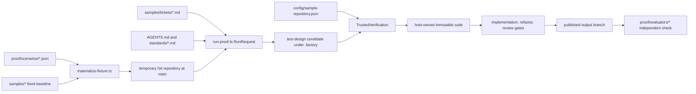

# VSA API proof scenario — implementation plan

Status: proposed, repository-grounded design. This document plans the scenario; no fixture, ticket, evaluator, or proof-run configuration described below has been implemented.

Authority: [Software Factory POC brief](software-factory-poc-brief.md), [factory implementation plan](software-factory-poc-implementation-plan.md), and the current executable proof harness. Where this document proposes new behavior, it labels that behavior **Proposal**.

## 1. Outcome and boundaries

Add one independent proof scenario, `vsa-feature`, in which an agent adds an **Adjust pending reservation quantity** slice to a functioning .NET 10 inventory API that already has five meaningful slices. The fixture must make Vertical Slice Architecture visible in file ownership and dependency direction, while retaining the proof suite's existing local-first, fixed-baseline, trusted-test, independent-evaluator, and real-model workflows.

This scenario is additive. It does not replace the existing `feature`, `bug`, `refactor`, `recovery-success`, or `recovery-exhaustion` cases; change their tickets; introduce a database; or create a generic VSA framework. The implementation remains one ASP.NET Core process with deterministic in-memory state and no authentication, external service, network dependency, mediator, repository layer, or new NuGet package.

## 2. Current-state findings

### 2.1 Proof lifecycle

The implemented lifecycle is:



Concrete ownership and behavior:

- `proof/harness/scenario.ts` validates `id`, fixture, ticket, standards, evaluator, optional expected solution, and deterministic attempt faults. A normal feature needs no schema extension.
- `proof/harness/materialize-fixture.ts` copies a selected `samples/<scenario>` tree without `bin`, `obj`, or `.git`, writes the fixture `.gitignore`, initializes `main`, and commits the baseline.
- `proof/harness/run-proof.ts` materializes that fixture, parses the Markdown ticket, combines configured and scenario standards, creates the isolated run, and invokes the independent evaluator on the published checkout only after a successful normal scenario.
- `config/sample-repository.json` defines the reusable .NET build and executable-test commands, candidate suite location, protected HTTP runner, stage/final checks, and excluded generated paths. Any fixture retaining `src/Inventory.Api` and `tests/Inventory.Tests` works without a second repository profile.
- `packages/verification/src/trusted-verification.ts` runs baseline checks, snapshots a read-only original baseline, validates the test-design candidate against that baseline, promotes it to a host-owned immutable suite, and reruns it at downstream gates.
- `standards/acceptance-test-design.md` defines candidate `manifest.json` plus declarative JSON HTTP cases. Each case starts a fresh API process; it can assert status and dotted JSON values and capture a response property as `${reservationId}`.
- `proof/harness/trusted_acceptance.py` is the host-owned interpreter. Feature candidates are valid RED evidence only when they discover tests and fail with the configured assertion exit code `1`, not on setup or infrastructure.
- `proof/evaluators/api_evaluator.py` starts the real API on an ephemeral loopback port and checks observable HTTP behavior. `proof/evaluators/{feature,bug}.sh` select its current modes. Evaluators and `proof/expected/*` remain outside the materialized agent repository.
- `tests/integration/preflight.test.ts` proves the feature fixture can be materialized, pass baseline build/tests, and produce intentional assertion RED against the protected runner.
- `README.md` and `docs/runbook-suite.md` enumerate the five real-model scenarios. `docs/verification-evidence.md` records observed results and must only be changed after commands are actually run.

### 2.2 Existing sample conventions

- All five fixtures target `net10.0`, enable nullable references and implicit usings, treat warnings as errors, and use an ASP.NET Core minimal API project plus a dependency-free console test executable.
- `samples/*/AGENTS.md` supplies fixture-local architecture and safety rules. `standards/inventory-api-skill.md` supplies reservation states, transition, case normalization, atomicity, cancellation, and dependency rules.
- The current `samples/feature` fixture is deliberately thin: health plus inventory list/get/set. The current expected feature solution adds reservation creation, confirmation, and cancellation in one `Program.cs`/`ReservationStore` implementation. It is appropriate for proving a medium feature, but not for proving that an agent can preserve and extend established slice boundaries.
- Existing deterministic commands are `dotnet build src/Inventory.Api/Inventory.Api.csproj --nologo` and `dotnet run --project tests/Inventory.Tests/Inventory.Tests.csproj`. Existing evaluators prove the HTTP surface independently; the console tests are not the authoritative acceptance suite.
- The current environment record in `docs/runtime-compatibility.md` says Docker/Podman and a compatible configured vLLM endpoint are unavailable. Deterministic implementation verification can still complete; real-model proof results must remain `BLOCKED` until those prerequisites exist.

## 3. Integration decision

### Chosen: add a sixth, independent `vsa-feature` scenario

**Proposal.** Add `samples/vsa-feature`, `samples/tickets/vsa-feature.md`, `proof/scenarios/vsa-feature.json`, `proof/expected/vsa-feature`, and `proof/evaluators/vsa-feature.sh`. Extend the existing API evaluator with a `vsa-feature` mode rather than adding another process-launch implementation. Reuse the scenario schema, materializer, repository profile, protected runner, and factory orchestration unchanged.

Why this is the smallest useful integration:

1. The existing `feature` baseline must remain a stock-only fixture; changing it would alter the established reservation ticket and both recovery fixtures.
2. The new baseline can demonstrate five working, separately owned use cases before the ticket starts. That is distinct proof value rather than a renamed version of the current feature case.
3. One new scenario entry exercises all existing materialization, stage, verification, publication, and evaluator paths. No production factory contract changes are required.
4. The independent fixture prevents the new VSA conventions from silently changing the bug/refactor baselines or their expected solutions.

### Rejected alternatives

| Alternative | Rejection reason |
|---|---|
| Replace `samples/feature` | It would destroy the existing stock-to-reservations proof and force recovery scenarios, expected solution, evidence, and evaluator semantics to change without need. |
| Extend every existing fixture to VSA | It multiplies migration risk and duplicates work across bug/refactor/recovery cases; the objective needs one representative scenario. |
| Derive the VSA fixture from `proof/expected/feature` | Expected solutions are evaluator oracles, not fixture inputs. Coupling a baseline to a hidden solution would blur the trust boundary and make independent fixtures less explicit. |
| Add a second repository profile or acceptance runner | Paths and commands remain identical, and the existing runner can express all required sequential HTTP invariants. A second profile/runner would duplicate infrastructure. |
| Add EF Core, SQLite, MediatR, or a VSA framework | The repository intentionally uses a compact dependency-free sample. These additions do not improve the target behavior and increase restore/runtime variability. |

## 4. Baseline application design

### 4.1 Architecture and dependency rules

The API uses four explicit buckets adapted to this compact fixture:

- **Slices:** one file per HTTP capability under `Features/Inventory` or `Features/Reservations`. Each owns route registration, request/response DTOs, handler orchestration, and its business decision logic.
- **Feature groups:** inventory and reservations group related slices; one slice never calls another slice.
- **Composition root:** `Program.cs` creates the singleton state, maps health, and invokes each slice's `Map` method. Route wiring only; no business rule.
- **Shared state:** `Data/InventoryState.cs` owns synchronization, seeded dictionaries, and persistence-shaped records only. It does not decide whether a reservation may be created, confirmed, cancelled, or adjusted.

Manual mapping is intentional. Five explicit `Map` calls are clearer than reflection scanning and avoid inventing a framework for one fixture. Each slice may directly read/mutate the shared in-memory state while holding its single synchronization lock. This is the in-memory equivalent of a direct transactional data-context dependency: stock and reservation changes in one operation are atomic, and business rules remain in the owning slice.

Mechanical rules to place in `samples/vsa-feature/AGENTS.md` and mirror in the expected solution:

- A file under `Features/*` may use `Data/*` and ASP.NET Core, but must not reference another `Features/*` slice.
- `Data/*` must not reference `Features/*` or contain transition/quantity policy.
- `Program.cs` contains composition only.
- Do not add controllers, services, repositories, MediatR, external persistence, or package dependencies.
- Preserve case-insensitive SKU identity and uppercase response representation.
- Every stock/reservation multi-value mutation occurs while holding the one `InventoryState` lock.
- Keep operation methods `internal` and expose internals only to `Inventory.Tests`, so console tests exercise decisions without moving behavior into a test-only abstraction.

### 4.2 Five existing slices

`GET /health` remains host readiness plumbing and is not counted as a business slice.

| Slice and owned file | HTTP contract | State/rules | Functional role |
|---|---|---|---|
| **Get inventory** — `Features/Inventory/GetInventory.cs` | `GET /inventory/{sku}` → `200 { sku, available }`; unknown SKU → `404` | Read-only; ordinal-ignore-case lookup; uppercase SKU response | Makes stock consequences observable to all proof checks. |
| **Receive stock** — `Features/Inventory/ReceiveStock.cs` | `POST /inventory/{sku}/receipts` with `{ quantity }` → `200 { sku, available }`; blank SKU or quantity `<= 0` → `400` | Atomically creates or increments a SKU; integer overflow is rejected with `409` and no mutation | Supplies a realistic stock-ingress capability and lets independent checks isolate cases with dedicated SKUs. |
| **Create reservation** — `Features/Reservations/CreateReservation.cs` | `POST /reservations` with `{ sku, quantity }` → `201`, `Location: /reservations/{id}`, and `{ id, sku, quantity, status: "Pending" }`; malformed/non-positive → `400`; unknown SKU → `404`; insufficient stock → `409` | Under one lock, validate available stock, decrement it, and add one GUID-keyed pending reservation; no partial mutation | Establishes reservation identity and the stock-allocation invariant consumed by later slices. |
| **Confirm reservation** — `Features/Reservations/ConfirmReservation.cs` | `POST /reservations/{id:guid}/confirm` → `204`; unknown → `404`; non-pending → `409` | Pending → Confirmed only; available stock is unchanged | Supplies one terminal transition and proves confirmed allocation stays consumed. |
| **Cancel reservation** — `Features/Reservations/CancelReservation.cs` | `POST /reservations/{id:guid}/cancel` → `204`; unknown → `404`; non-pending → `409` | Pending → Cancelled and restore the reservation's current quantity exactly once in the same lock | Supplies the compensating transition whose behavior the new slice must preserve after quantity changes. |

Seed `WIDGET` with available quantity `10`. Other SKUs are created through the receipt slice. IDs may be random GUIDs because tests capture them from responses; no clock, random business decision, or order-dependent global fixture is introduced.

### 4.3 Baseline executable tests

`tests/Inventory.Tests/Program.cs` remains the repository-standard dependency-free executable. It directly invokes each slice's internal operation method against a new `InventoryState` and must cover:

- case-insensitive `WIDGET` lookup and uppercase output;
- positive receipt and rejected non-positive receipt without mutation;
- successful reservation decrement and rejected over-reservation without mutation;
- confirmation preserving consumed stock and rejecting a second/conflicting transition;
- cancellation restoring once and rejecting repetition.

These are behavior/state assertions, not route-wiring or source-layout checks. Full routing, serialization, and status behavior remains the responsibility of the protected HTTP suite and independent evaluator.

## 5. Ticketed slice: adjust a pending reservation

### 5.1 Public contract

**Proposal.** Ticket title: `Adjust a pending inventory reservation`.

Add `PATCH /reservations/{id:guid}` with body:

```json
{ "quantity": 7 }
```

Success returns `200` with the complete stable reservation representation:

```json
{
  "id": "<captured-guid>",
  "sku": "WIDGET",
  "quantity": 7,
  "status": "Pending"
}
```

Outcome rules:

| Condition | Status | Mutation |
|---|---:|---|
| Positive quantity, pending reservation, requested quantity is larger, and the delta is available | `200` | Subtract only `requested - current` from available; update reservation quantity atomically. |
| Positive quantity, pending reservation, requested quantity is smaller | `200` | Add `current - requested` to available; update reservation quantity atomically. |
| Positive quantity equals current quantity | `200` | No state change; return the current representation. |
| Quantity `<= 0` | `400` validation problem | None. |
| Reservation ID is unknown | `404` | None. |
| Reservation is Confirmed or Cancelled | `409` | None. |
| Increase delta exceeds available stock or would overflow a stock count | `409` | Neither stock nor reservation changes. |

The route file is `Features/Reservations/AdjustReservationQuantity.cs`. It owns `AdjustReservationQuantityRequest`, the success DTO/mapping it needs, the handler, and an internal pure calculation/decision type if extraction improves readability. It may use `Data/InventoryState.cs`; it must not call create, confirm, cancel, or inventory slice methods.

### 5.2 Consequential interactions

- **Creation:** an adjustment changes only the quantity already reserved; it never changes SKU or reservation identity.
- **Inventory:** available stock moves by the delta, not by the full replacement quantity.
- **Cancellation:** after an adjustment, cancellation restores the adjusted quantity exactly once.
- **Confirmation:** after a decrease, confirmation leaves only the adjusted quantity consumed; after confirmation, adjustment is forbidden.
- **Failure atomicity:** insufficient stock, invalid quantity, unknown ID, and terminal state leave both dictionaries unchanged.
- **Concurrency:** the lookup, eligibility check, delta check, stock mutation, and reservation mutation remain in one `InventoryState` critical section. Concurrent increases therefore cannot make available stock negative.

### 5.3 Proposed ticket acceptance criteria

The future `samples/tickets/vsa-feature.md` should use these stable IDs and observable wording:

- **INV-VSA-001:** Increasing a pending reservation reserves only the additional quantity and returns the updated pending reservation.
- **INV-VSA-002:** Decreasing a pending reservation releases only the difference; later confirmation keeps the adjusted quantity consumed, while later cancellation restores the adjusted quantity exactly once.
- **INV-VSA-003:** An increase whose delta exceeds available stock returns `409` and leaves both reservation quantity and available stock unchanged.
- **INV-VSA-004:** A zero or negative requested quantity returns `400` and leaves reservation and stock unchanged.
- **INV-VSA-005:** Confirmed and cancelled reservations reject adjustment with `409`; an unknown reservation returns `404`; all failures are mutation-free.
- **INV-VSA-006:** Existing inventory receipt, reservation creation, confirmation, and cancellation behavior remains intact, including non-negative stock and case-insensitive SKU identity.

The ticket body should explicitly require one new reservation slice, existing folder/dependency conventions, and an atomic operation. Criterion wording remains behavioral; VSA conformance is enforced by repository instructions and whole-diff review rather than a brittle source-text acceptance test.

## 6. Proposed repository layout

```text
samples/
  vsa-feature/
    AGENTS.md
    src/Inventory.Api/
      Inventory.Api.csproj
      Program.cs
      Properties/AssemblyInfo.cs             # InternalsVisibleTo Inventory.Tests
      Data/
        InventoryState.cs                    # lock, seeded state, persistence records only
      Features/
        Inventory/
          GetInventory.cs
          ReceiveStock.cs
        Reservations/
          CreateReservation.cs
          ConfirmReservation.cs
          CancelReservation.cs
          # AdjustReservationQuantity.cs is absent in the baseline
    tests/Inventory.Tests/
      Inventory.Tests.csproj
      Program.cs
  tickets/
    vsa-feature.md
proof/
  scenarios/
    vsa-feature.json
  evaluators/
    api_evaluator.py                         # add isolated vsa-feature mode
    vsa-feature.sh                           # executable mode adapter
  expected/
    vsa-feature/
      AGENTS.md
      src/Inventory.Api/                     # baseline plus solved adjustment slice
      tests/Inventory.Tests/                 # baseline plus adjustment behavior tests
docs/
  vsa-api-proof-scenario-implementation-plan.md
```

`proof/scenarios/vsa-feature.json` must contain:

```json
{
  "id": "inventory-vsa-feature",
  "fixture": "samples/vsa-feature",
  "ticket": "samples/tickets/vsa-feature.md",
  "standards": ["standards/inventory-api-skill.md"],
  "evaluator": "proof/evaluators/vsa-feature.sh",
  "expectedSolution": "proof/expected/vsa-feature",
  "faults": []
}
```

No change is planned for `proof/harness/scenario.ts`, `proof/harness/materialize-fixture.ts`, `proof/harness/trusted_acceptance.py`, `config/sample-repository.json`, or production factory packages. A need to change one of them is a design-review stop: first show why the existing contract cannot run the scenario.

## 7. Acceptance-suite and evaluator design

### 7.1 Authoritative test-design cases

The test-design agent writes these cases under `.factory/acceptance-candidate/`; the verifier promotes accepted content under `<trustedRoot>/<run-id>/runs/<hash>/suites/vN/content` and later integrates it at `tests/Factory.Acceptance` according to `config/sample-repository.json`.

The plan does not commit a fixed authoritative suite. It defines the minimum adequacy the test-design rationale and reviewer must require:

| Candidate case | Steps and assertions | Criteria |
|---|---|---|
| `increase_then_cancel` | Create quantity 4; capture ID; patch to 7; assert pending quantity 7; inventory is 3; cancel; inventory returns to 10 | INV-VSA-001, INV-VSA-002 |
| `decrease_then_confirm` | Create quantity 6; patch to 2; inventory is 8; confirm; cancellation conflicts; inventory remains 8 | INV-VSA-002 |
| `insufficient_increase_rolls_back` | Create quantity 4; patch to 11 returns 409; cancel; inventory returns to 10 | INV-VSA-003 |
| `invalid_quantity_rolls_back` | Create quantity 4; patch to 0 returns 400; cancel; inventory returns to 10; repeat in a separate case with a negative value | INV-VSA-004 |
| `terminal_and_unknown_rejections` | Confirm one reservation and reject patch; cancel another and reject patch; patch a fixed absent GUID and receive 404; verify stock after each | INV-VSA-005 |
| `existing_slices_remain_consistent` | Receive a lowercase SKU, create against an uppercase/lowercase variant, then confirm or cancel and assert resulting stock | INV-VSA-006 |

Every case uses a fresh process, so seed state is deterministic. The current `${reservationId}` capture is sufficient; no runner feature is needed. A candidate containing only one happy-path quantity change is inadequate even if it maps every criterion in `manifest.json`.

Expected test-design gate result:

- baseline builds and local tests pass;
- candidate cases are discovered;
- adjustment cases fail by HTTP assertion because `PATCH /reservations/{id}` returns `404` on the baseline;
- setup/infrastructure failures do not count as RED;
- production digest remains unchanged during test design.

### 7.2 Independent evaluator

`proof/evaluators/vsa-feature.sh` delegates to `api_evaluator.py vsa-feature <repository>`. The new mode should reuse the existing ephemeral-port process lifecycle and request helper, then use distinct SKUs created through receipts to isolate sequences in one API process.

Required checks:

1. Read seeded inventory and exercise receipt, create, confirm, and cancel before checking adjustment, proving the baseline is functional.
2. Increase a reservation by a delta different from the ticket example; assert response, available stock, and cancellation restoration.
3. Decrease another reservation; confirm it; reject cancellation; assert only the adjusted quantity remains consumed.
4. Repeat the same positive quantity and assert a successful no-op.
5. Reject an over-large increase, then cancel and prove both quantity and stock effectively rolled back.
6. Reject zero and negative quantities without mutation.
7. Reject adjustment after confirmation and cancellation, and return 404 for a fixed absent GUID.
8. Send two competing increases against reservations sharing one SKU concurrently; require one or the permitted number of successes based on available deltas, all others `409`, and final available stock never below zero. Finish by cancelling remaining pending reservations and verify conservation.

The concurrency check is independent evaluator depth, not a new declarative-runner primitive. It follows the ticket's atomicity requirement and the fixture's existing lock rule.

### 7.3 Baseline-fail / solution-pass contract

- `proof/evaluators/vsa-feature.sh samples/vsa-feature` must exit nonzero only when it reaches the missing adjustment endpoint and receives `404`; readiness and all five baseline-slice checks must have passed first.
- `proof/evaluators/vsa-feature.sh proof/expected/vsa-feature` must exit `0` after all happy, boundary, rollback, terminal, preservation, and concurrent-conservation checks.
- The expected solution is a manually reviewed oracle and is never copied into the agent workspace. In the current harness, a non-null `expectedSolution` marks a normal success scenario; deterministic oracle validation remains an explicit repository command.
- The evaluator must not inspect file names, count classes, reflect over method names, or accept one canned quantity. Its defense against superficial work is varied HTTP sequences and conservation checks.

## 8. Artifact change set

| Path | Planned responsibility |
|---|---|
| `samples/vsa-feature/**` | Fixed, buildable five-slice baseline and local behavioral tests. Adjustment route absent. |
| `samples/vsa-feature/AGENTS.md` | VSA boundaries, atomic state rule, commands, protected-input restrictions, and prohibited layers/dependencies. |
| `samples/tickets/vsa-feature.md` | Ticket text and six criterion IDs from section 5.3. |
| `proof/expected/vsa-feature/**` | Complete reviewed implementation and focused local tests for adjustment policy and integration with cancellation/confirmation. |
| `proof/scenarios/vsa-feature.json` | Fixture/ticket/standard/evaluator/oracle binding with no injected fault. |
| `proof/evaluators/vsa-feature.sh` | Executable adapter selecting the evaluator mode. |
| `proof/evaluators/api_evaluator.py` | Add VSA behavior mode while preserving current `feature` and `bug` results. |
| `tests/integration/preflight.test.ts` | Extract the existing scenario setup into a small local helper and add one VSA case proving baseline preflight plus intentional assertion RED for the missing PATCH endpoint. Do not duplicate verifier implementation assertions. |
| `README.md` | Add the planning link during planning; during implementation add `vsa-feature` to fixture/proof command lists and describe six scenarios without rewriting existing evidence claims. |
| `docs/runbook-suite.md` | Add `vsa-feature` to the sequential run loop and expected successful outcomes. |
| `docs/software-factory-poc-implementation-plan.md` | Amend Phase 5/fixture matrix to identify the additive architecture-feature scenario; retain the original five-case commitment. |
| `docs/verification-evidence.md` | Update only after commands run: record deterministic baseline-fail/oracle-pass facts and either real proof evidence or an honest runtime blocker. |

Do not add aliases for old scenario names, duplicate evaluator entry points, a second config profile, or compatibility shims. Existing scenario semantics remain unchanged, so there is no data migration. Generated `bin`, `obj`, `.dotnet`, materialized repositories, and run evidence must not be committed as fixture content.

## 9. Ordered delivery phases

### Phase 1 — Build and prove the five-slice baseline

**Depends on:** none.

**Files:** `samples/vsa-feature/AGENTS.md`, `samples/vsa-feature/src/Inventory.Api/**`, `samples/vsa-feature/tests/Inventory.Tests/**`.

**Changes:** create the composition root, shared state records, five slice files, project files, internals exposure, and behavior-focused executable tests. Keep adjustment absent. Use the existing project settings exactly.

**Completion evidence:** baseline build and test executable exit `0`; start the API on an ephemeral port and observe health, receipt, creation, confirmation, cancellation, and inventory conservation; `PATCH /reservations/<guid>` returns `404`.

**Risks:** shared state may become a service layer. Review that it owns only storage/synchronization and that every rule is in one slice. Route handlers may call other slice helpers; reject that dependency rather than hiding it.

### Phase 2 — Specify the ticket and trusted RED path

**Depends on:** Phase 1.

**Files:** `samples/tickets/vsa-feature.md`, `proof/scenarios/vsa-feature.json`, `tests/integration/preflight.test.ts`.

**Changes:** add the exact six criteria; bind the fixture to current standard/evaluator paths; parameterize only enough preflight test setup to run both the existing feature case and the new PATCH-missing case.

**Completion evidence:** ticket parser accepts all IDs; materialization creates a clean `main`; trusted preflight passes baseline commands; a representative candidate adjustment case is discovered and accepted as assertion RED against the read-only original baseline.

**Risks:** mapping all criteria to one shallow 404 test could pass schema validation. The test rationale and fixture-specific preflight case must demonstrate a valid missing-contract RED, while section 7.1 governs suite adequacy during review.

### Phase 3 — Implement and prove the expected solution

**Depends on:** Phases 1–2.

**Files:** `proof/expected/vsa-feature/**`.

**Changes:** copy the reviewed baseline source, add only `AdjustReservationQuantity.cs` plus focused test changes, and preserve the five existing slices. Implement delta calculation, state eligibility, stock conservation, exact status mapping, and one-lock mutation.

**Completion evidence:** expected solution builds/tests; manual HTTP smoke observes increase, decrease, same-value, rollback, terminal rejection, and adjusted cancellation/confirmation behavior.

**Risks:** copying can drift baseline files. Compare intended source manifests during review: expected solution should differ only by the new slice, its `Program.cs` map call, and tests/instructions that describe completed behavior.

### Phase 4 — Add the independent evaluator

**Depends on:** Phase 3 because the oracle fixes the intended contract.

**Files:** `proof/evaluators/api_evaluator.py`, `proof/evaluators/vsa-feature.sh`.

**Changes:** add the isolated evaluator mode and make the shell adapter executable. Preserve existing modes byte-for-behavior: no status or payload expectation changes for `feature`, `bug`, or `refactor`.

**Completion evidence:** baseline exits nonzero at missing PATCH after baseline checks; expected solution exits `0`; existing feature, bug, and refactor expected solutions still pass their evaluators; malformed implementations that apply the full requested quantity, mutate before rejecting, or allow terminal adjustment fail.

**Risks:** a concurrent check can be flaky if it assumes request ordering. Assert conservation and permitted success counts, never which request wins. Use bounded joins/timeouts and report response/status details on failure.

### Phase 5 — Integrate commands and documentation

**Depends on:** Phases 1–4.

**Files:** `README.md`, `docs/runbook-suite.md`, `docs/software-factory-poc-implementation-plan.md`; `docs/verification-evidence.md` only with observed evidence.

**Changes:** add `vsa-feature` to fixture build/test and real-proof loops, successful-outcome text, fixture matrix, and plan checklist. Keep the original five scenarios and describe this as an additional architecture feature scenario. Remove no old command/path.

**Completion evidence:** every documented path resolves; copied shell loops execute all six fixtures/scenarios; documentation distinguishes deterministic checks from model proof and does not claim unavailable runtime evidence.

**Risks:** changing “five proof runs” to “six” can accidentally rewrite historical scope claims. Preserve statements about the established five-case matrix; state that this plan adds a sixth case.

### Phase 6 — Deterministic suite verification and real proof

**Depends on:** Phases 1–5.

**Files:** no new production files; evidence outputs remain under ignored `.runs/` and `.factory-trusted/`. Update `docs/verification-evidence.md` from observations only.

**Changes:** run the matrix in section 10, inspect the expected baseline failure, and remove all temporary fixture/materialization directories outside ignored run roots. If Docker and vLLM prerequisites exist, run one new real proof with a unique ID and inspect its branch/report. If unavailable, record `BLOCKED` and stop; do not substitute deterministic results.

**Completion evidence:** all deterministic rows have their expected result; real proof either has an inspected report/branch/evaluator pass or an explicit prerequisite blocker.

**Risks:** proof reruns can hide nondeterministic model failures. Follow `docs/runbook-suite.md`: never reuse a run ID and retain the first report.

## 10. Verification matrix

Run from repository root. `PROOF_ID` and output paths must be unique.

| Scope | Command | Expected outcome |
|---|---|---|
| Baseline build | `dotnet build samples/vsa-feature/src/Inventory.Api/Inventory.Api.csproj --nologo` | Exit 0, no warnings. |
| Baseline local behavior | `dotnet run --project samples/vsa-feature/tests/Inventory.Tests/Inventory.Tests.csproj` | Exit 0 with all five-slice behavior assertions executed. |
| Oracle build | `dotnet build proof/expected/vsa-feature/src/Inventory.Api/Inventory.Api.csproj --nologo` | Exit 0, no warnings. |
| Oracle local behavior | `dotnet run --project proof/expected/vsa-feature/tests/Inventory.Tests/Inventory.Tests.csproj` | Exit 0 including adjustment policy and cross-slice conservation assertions. |
| Fixture materialization | `npx tsx proof/harness/materialize-fixture.ts proof/scenarios/vsa-feature.json /tmp/factory-vsa-feature` | Fresh Git repository on `main`; no generated outputs or adjustment slice. |
| Materialized baseline checks | `dotnet build /tmp/factory-vsa-feature/src/Inventory.Api/Inventory.Api.csproj --nologo && dotnet run --project /tmp/factory-vsa-feature/tests/Inventory.Tests/Inventory.Tests.csproj` | Both exit 0. |
| Baseline negative evaluator | `proof/evaluators/vsa-feature.sh samples/vsa-feature` | Expected nonzero assertion after readiness and existing-slice checks; missing PATCH is the cause. |
| Oracle positive evaluator | `proof/evaluators/vsa-feature.sh proof/expected/vsa-feature` | Exit 0 with all independent HTTP/conservation checks. |
| Existing evaluator regression | `proof/evaluators/feature.sh proof/expected/feature && proof/evaluators/bug.sh proof/expected/bug && proof/evaluators/refactor.sh proof/expected/refactor` | Exit 0 for all three. |
| Focused trusted integration | `npm test -- --run tests/integration/preflight.test.ts` | Existing and VSA materialization/preflight/intentional-RED cases pass. |
| Full deterministic factory suite | `npm run check` | Typecheck, dependency checks, and all deterministic tests pass. |
| All fixture builds/tests | `for fixture in feature bug refactor recovery-success recovery-exhaustion vsa-feature; do dotnet build "samples/$fixture/src/Inventory.Api/Inventory.Api.csproj" --nologo && dotnet run --project "samples/$fixture/tests/Inventory.Tests/Inventory.Tests.csproj"; done` | Every fixture baseline is independently green. |
| Real model proof | `PROOF_ID="$(date +%s)"; npx tsx proof/harness/run-proof.ts config/factory.local.json proof/scenarios/vsa-feature.json "factory/proof-vsa-feature-$PROOF_ID" "$PROOF_ID-vsa-feature"` | With prerequisites: terminal `succeeded`, new branch, trusted gates green, independent evaluator green. Without Docker/vLLM: report exact infrastructure blocker; do not claim proof success. |
| Published branch inspection | `cat ".runs/evidence/$PROOF_ID-vsa-feature/report.json"` and `git -C ".runs/proof-inputs/inventory-vsa-feature-$PROOF_ID-vsa-feature/source" show --stat "factory/proof-vsa-feature-$PROOF_ID"` | Report identifies all four fresh stages; branch contains one coherent slice plus legitimate tests and no evaluator/oracle files. |

For the API smoke required before evaluator integration, launch with an ephemeral explicit URL using the repository pattern:

```bash
PORT=5087
DOTNET_CLI_HOME=/tmp/factory-vsa-dotnet \
  dotnet run --no-launch-profile \
  --project samples/vsa-feature/src/Inventory.Api/Inventory.Api.csproj \
  --urls "http://127.0.0.1:$PORT"
```

Use a free port in implementation; `5087` is illustrative, not reserved. Exercise the HTTP sequences from sections 4 and 5, then terminate the process. The evaluator remains the repeatable ephemeral-port proof.

## 11. Risks, assumptions, and material decisions

| Item | Status | Treatment |
|---|---|---|
| In-memory persistence is sufficient for VSA proof | **Decision** | The scenario proves capability ownership, state transitions, and atomic in-process invariants, not database/provider behavior. External persistence is out of scope. |
| Five baseline slices | **Decision** | Count only business capabilities; health is readiness plumbing. This hits the requested target exactly without filler endpoints. |
| Shared mutable state can blur slice ownership | **Risk** | Keep it persistence-only, expose one lock, forbid feature references, and review each rule's owning slice. Do not create `ReservationService`. |
| Manual composition versus endpoint discovery | **Decision** | Manual `Map` calls are explicit and compact. Reflection/DI discovery would be a generic framework unsupported by current fixtures. |
| Declarative runner lacks parallel steps | **Known limit** | Sequential authoritative tests prove rollback and conservation; the independent evaluator adds a bounded concurrent conservation check. No runner extension is justified for one case. |
| Candidate tests are model-authored, not committed here | **Decision** | The verifier's existing test-design stage remains authoritative. Section 7.1 supplies adequacy requirements and the independent evaluator prevents one-example overfitting. |
| Existing `expectedSolution` field is not itself run by `run-proof.ts` | **Current fact** | Keep the field for normal-scenario semantics and run the oracle evaluator explicitly during deterministic verification. Do not broaden the scenario contract in this change. |
| Existing evaluator modes could regress | **Risk** | Add a distinct mode branch and rerun all three current expected-solution evaluators before documentation/evidence updates. |
| Integer overflow | **Decision** | Receipt and adjustment reject overflow with `409` and no mutation; this preserves non-negative stock without introducing larger numeric types. |
| Real model/container availability | **Unresolved external prerequisite** | Current repository evidence says unavailable. Complete deterministic work, then report real proof `BLOCKED` unless Docker, image, endpoint, and exact model ID are actually present. |
| Exact model success on a nontrivial slice | **Unknown until proof** | One autonomous run is the evidence. Do not weaken acceptance criteria or rerun under the same ID to manufacture success. |

No material product decision remains for implementation. The new endpoint, statuses, state rules, file ownership, proof artifacts, evaluator depth, commands, and blocked-runtime behavior are fixed by this plan. Any proposed deviation that changes those contracts should update this document before code is changed.
